<p align="center">
  
</p>

<p align="center"><b>El nieto que nunca te deja solo ante una estafa.</b><br>
<i>Antes de tocar un mensaje raro, pregúntale a Sonny.</i></p>

<p align="center">
  <a href="https://github.com/JkalasG/sonny/actions/workflows/ci.yml"></a>
  
  
  
  
</p>

<p align="center">
  🇬🇧 <a href="README.md">Read in English</a> · 🇪🇸 <b>Español</b>
</p>

<p align="center">
  <a href="#-correrlo-en-tu-computadora">Correrlo en tu computadora</a> ·
  <a href="#-nuestro-propio-modelo-para-detectar-estafas">Nuestro modelo</a> ·
  <a href="#-cómo-funciona">Cómo funciona</a> ·
  <a href="#-capturas">Capturas</a>
</p>

---

## 🔗 Enlaces

| | |
|---|---|
| 🏆 **Página en Devpost** | _agrega aquí el enlace de Devpost_ |
| 🎥 **Video de demostración (2:37)** | https://youtu.be/bzXX4HfKGzE · [MP4 en este repositorio](docs/video/sonny-demo.mp4) |
| 🌐 **Demo web en línea** | https://sonny-app-rosy.vercel.app/ |
| 📱 **APK de Android** | _agrega aquí el enlace de la compilación de EAS (opcional)_ |
| 💻 **Código fuente** | https://github.com/JkalasG/sonny |

Hecho para **Next Byte Hacks V5** (Devpost) durante el periodo del hackathon, noviembre de 2026.

---

## 💡 ¿Qué es Sonny?

**Sonny es un detector de estafas pensado para personas mayores y para cualquiera con poca experiencia digital.** Pegas un mensaje sospechoso (SMS, WhatsApp, correo) o subes una captura, y en segundos Sonny te dice:

- 🛑 **Estafa** / ⚠️ **Sospechoso** / ✅ **Parece normal**: un veredicto tipo semáforo en una sola frase grande.
- **Por qué**: las palabras sospechosas se resaltan dentro del mensaje y se explican los enlaces falsos.
- **Qué hacer ahora**: pasos sencillos, como "llama a tu banco al número de tu tarjeta" o "llama a un familiar".

Sonny habla como un nieto paciente y cariñoso ("Hiciste muy bien en preguntarme. Para eso estoy."). Funciona en **inglés y español**, con letra grande y botones grandes, y **funciona sin internet**.

### El problema

Los mensajes de *phishing* y *smishing* imitan a bancos, empresas de paquetería, oficinas del gobierno e incluso a familiares ("Hola mamá, se me rompió el celular…"). Las personas mayores están entre los objetivos más frecuentes. Muchas veces no tienen a quién preguntar en ese momento, y las herramientas que existen son muy técnicas o necesitan internet y mandan los mensajes privados a un servidor.

### Nuestra propuesta

1. **Nuestro propio modelo de aprendizaje automático funciona dentro del celular o del navegador.** Las estafas claras se detectan al instante y **nunca salen del equipo**.
2. Solo cuando el modelo duda, y solo si hay internet, Sonny le pide una **segunda opinión a una IA** (Google Gemini). Una tabla de decisión garantiza que la IA nunca pueda convertir un mensaje de alto riesgo en "parece normal".
3. **Reglas de enlaces** que detectan dominios falsos (`paypa1.com`, `bank-verify.xyz`, acortadores de enlaces, sitios sin HTTPS).
4. **Las fotos se leen en el propio equipo** (OCR). Si la IA no está disponible, el navegador (`tesseract.js`) o el celular (Google ML Kit, incluido en la APK) convierten la imagen en texto.

---

## ⚡ Demostración rápida para el jurado (prueba en 10 segundos sin escribir)

Si eres jurado del hackathon evaluando Sonny:
1. Abre la app (o ejecuta `npm run web` dentro de `app/`).
2. Ve a **Ejemplos** (o toca los botones de mensajes de prueba en la pantalla principal).
3. Toca **"Banco falso"** o **"Paquete retenido"**: Sonny detecta la estafa en **~0,1 ms en el propio equipo**, resalta las palabras peligrosas y explica los dominios falsos.
4. Toca **"Código del banco"** o **"Familia"**: comprueba cómo Sonny evita falsos positivos ante códigos 2FA legítimos de seguridad bancaria.
5. **Prueba sin conexión:** Activa el Modo Avión o apaga el WiFi. Sonny sigue analizando los mensajes en local sin enviar un solo byte a la nube.

---

## ⚡ Prueba rápida para el jurado (1 minuto, sin escribir)

1. Abre la **[demo en línea](https://sonny-app-rosy.vercel.app/)**. No hace falta cuenta, clave ni instalar nada.
2. Ve a **Examples** (Ejemplos) y toca **Fake bank** o **Package on hold**: Sonny marca la estafa, y **Why?** (¿Por qué?) resalta las palabras y el enlace falso.
3. Toca **Bank code** o **Family** ("Are you coming for dinner on Sunday?"): Sonny **no** da una falsa alarma con mensajes normales.
4. Ve a **Results** (Resultados) y presiona **Try the invisible-character attack**: la puntuación no cambia, porque arreglamos ese ataque.
5. **Prueba sin internet:** con la página abierta, apaga el Wi-Fi y revisa otro mensaje. El modelo propio y las reglas de enlaces siguen funcionando en el equipo.

> La demo pública está en **modo de prueba**: el modelo propio funciona de verdad y solo la segunda opinión de la IA es simulada (la pantalla "¿Por qué?" lo indica). Para usar la IA real, configura `AI_PROVIDER=gemini` y `AI_API_KEY` (ver [Correrlo en tu computadora](#-correrlo-en-tu-computadora)).

---

## 📸 Capturas

| Inicio (computadora) | Veredicto de estafa |
|---|---|
| 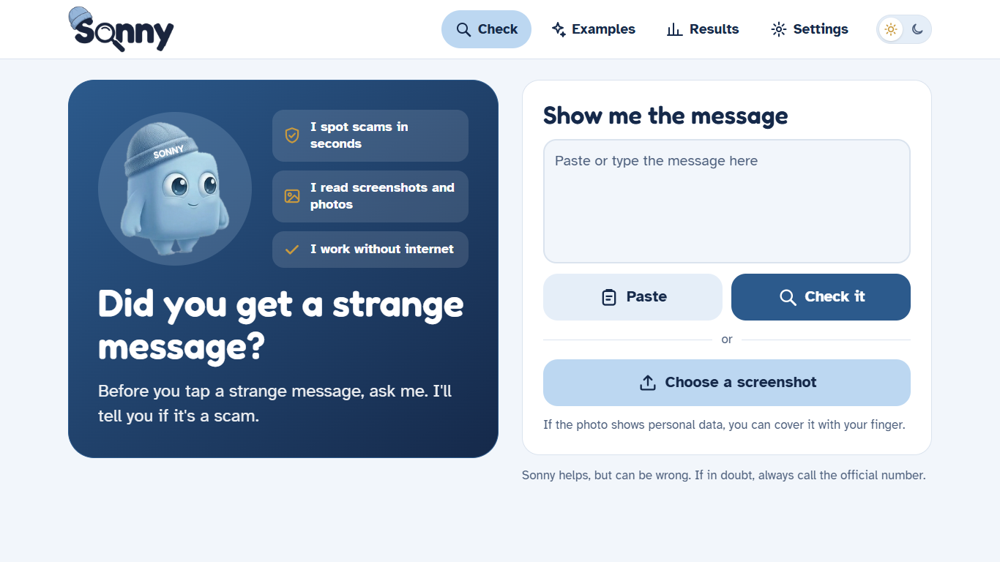 | 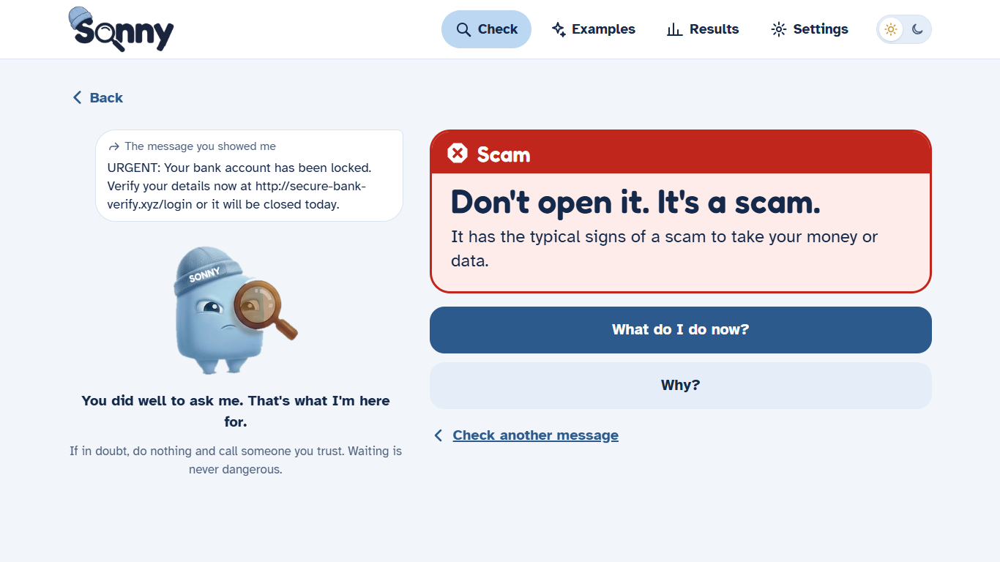 |
| **"¿Por qué?": palabras resaltadas y reglas de enlaces** | **Página de resultados del modelo, con demo en vivo** |
| 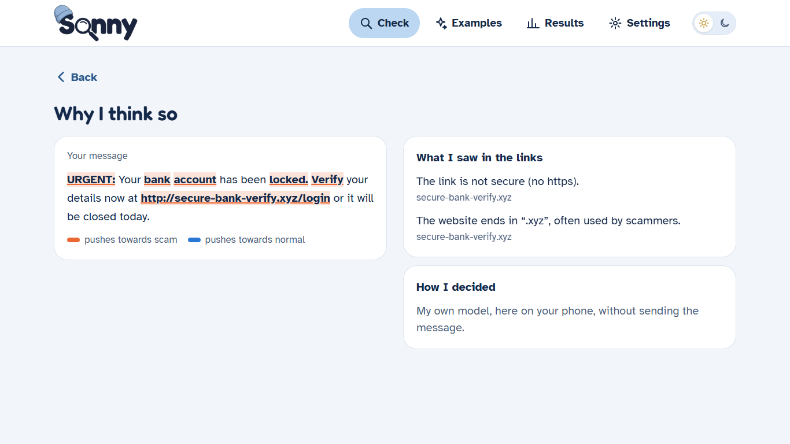 | 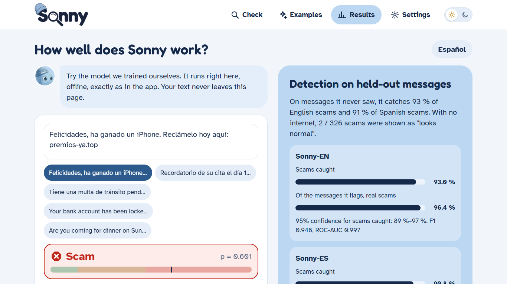 |
| **Modo oscuro** | **En el celular** |
| 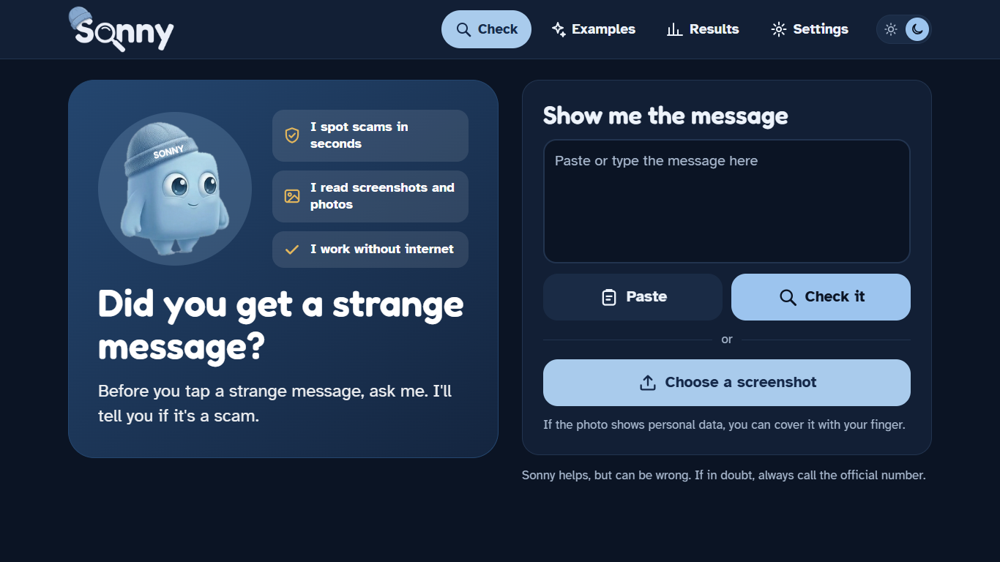 | 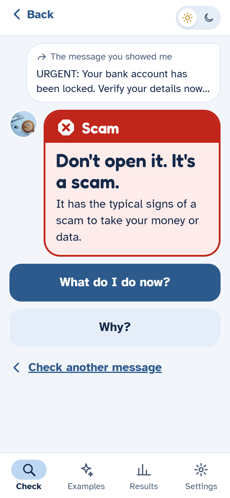 |

Las capturas muestran la app en inglés, el idioma por defecto. En la bienvenida y en Ajustes se cambia a español.

---

## 🔄 Cómo funciona

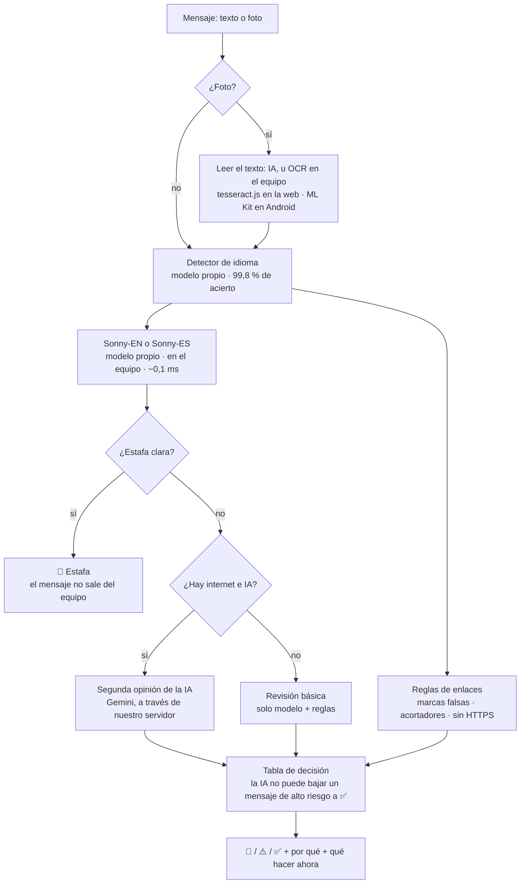

- **La clave de la IA nunca llega al celular.** La app llama a nuestro propio servidor (`/api/analyze`), que guarda la clave y limita el número de consultas.
- **No se guarda ningún mensaje ni foto.** Se procesan y se descartan.
- Si la IA tarda más de 14 segundos o falla, Sonny responde con su propio modelo.

---

## 🧠 Nuestro propio modelo para detectar estafas

El corazón de Sonny **no** es una llamada a una IA externa. **Entrenamos nuestros propios clasificadores** en Python, los exportamos a JSON y reescribimos el cálculo en TypeScript para que funcione dentro de la app, sin internet. Todo el trabajo está en [`modelo/`](modelo/).

### Lo que construimos

| Paso | Qué hicimos | Código |
|---|---|---|
| 1. Datos | Unimos 4 datasets públicos (inglés y español), los limpiamos, quitamos duplicados y **corregimos a mano 10 etiquetas equivocadas** | [`01_download.py`](modelo/01_download.py), [`02_prepare.py`](modelo/02_prepare.py) |
| 2. Modelo | N-gramas de caracteres (TF-IDF) + regresión logística, un modelo por idioma, más un detector de idioma | [`03_train.py`](modelo/03_train.py) |
| 3. Umbrales | Tres puntos de corte (normal / sospechoso / estafa) elegidos con validación cruzada de 5 particiones, **sin mirar el conjunto de prueba** | [`03_train.py`](modelo/03_train.py) |
| 4. Exportación | Modelos exportados a `.sonny` (JSON, 0,8 MB cada uno) y calculados en TypeScript **con exactamente el mismo resultado que en Python** | [`04_export.py`](modelo/04_export.py), [`js/scorer.ts`](modelo/js/scorer.ts) |
| 5. Evaluación | 17 análisis distintos: intervalos de confianza, alternativas, calibración, robustez, análisis de errores… | [`06_analisis.py`](modelo/06_analisis.py), [`ANALISIS_MODELO.md`](modelo/ANALISIS_MODELO.md) |
| 6. Pruebas | 18 pruebas en JS (coincidencia con Python, comportamiento), 17 en Python con barreras de calidad, 9 en la app | `npm test`, `npm run test:py` |

### Resultados (conjunto de prueba separado, 15 % de los datos)

| Modelo | Mensajes | Precisión | Recall (estafas detectadas) | F1 | ROC-AUC |
|---|---|---|---|---|---|
| **Sonny-EN** | 5.981 | 96,4 % | 93,0 % | 0,946 | 0,997 |
| **Sonny-ES** | 2.384 | 95,4 % | 90,8 % | 0,930 | 0,978 |
| **Detector de idioma** | 8.365 | exactitud 99,8 % | | | |

Sin internet, solo **el 0,7 % (EN) y el 0,5 % (ES) de las estafas** saldrían como "parece normal". El resto se marca 🛑 o ⚠️.

### ¿Por qué este modelo y no otro?

| Método | F1 EN | F1 ES |
|---|---|---|
| Lista de palabras clave (nuestra primera idea) | 0,610 | 0,571 |
| N-gramas de caracteres + Naive Bayes | 0,881 | 0,877 |
| TF-IDF de palabras + regresión logística | 0,926 | 0,930 |
| **Sonny: n-gramas de caracteres + regresión logística** | **0,946** | **0,930** |

Los n-gramas de caracteres además **aguantan mejor los errores de tipeo**: con el 30 % de las palabras mal escritas, el recall se mantiene en 92,3 % (EN) frente a 88,0 % del modelo de palabras.

### Un ataque real que encontramos y arreglamos

Nuestras pruebas de robustez aplicaron 10 transformaciones a cada mensaje de prueba (TODO EN MAYÚSCULAS, sin tildes, emojis, errores de tipeo, l33t…). Así descubrimos que **meter caracteres Unicode invisibles** (`U+200B`, `U+200C`) dentro de las palabras hacía caer el recall del modelo en español del **92 % al 57 %**. El modelo incluso había aprendido que `U+200C` significaba "legítimo", porque aparece en correos de marketing reales. Arreglamos el preprocesado y ahora el ataque **no tiene ningún efecto**.

### Gráficas

| | |
|---|---|
| 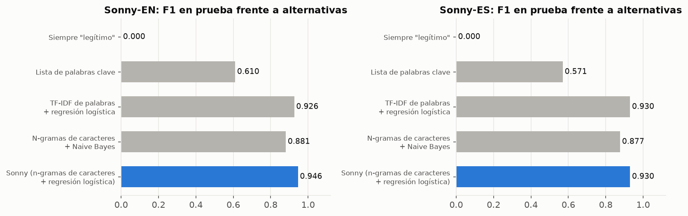 | 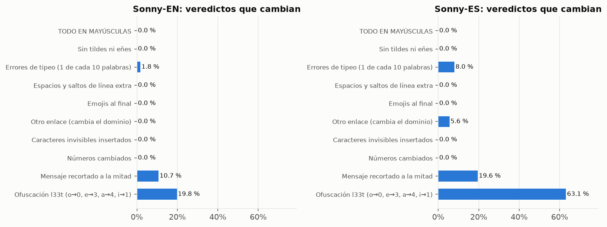 |
| 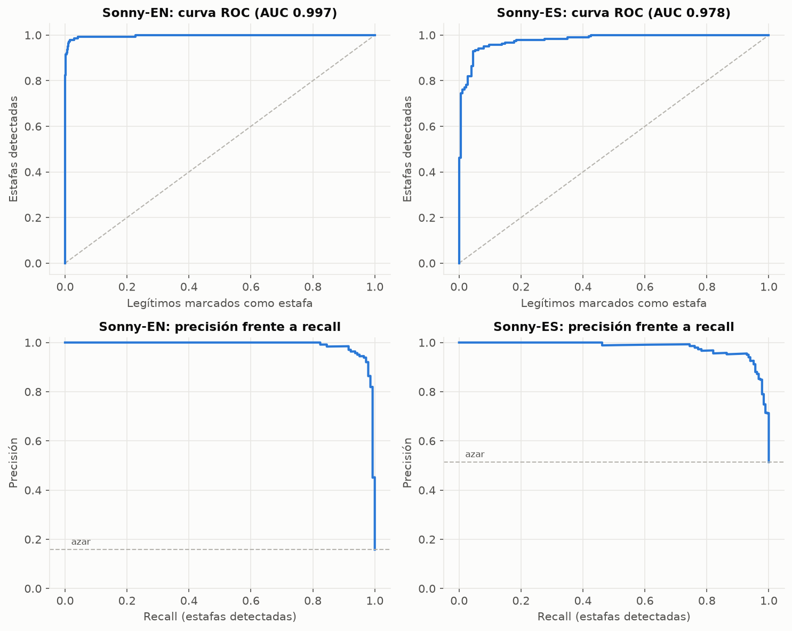 | 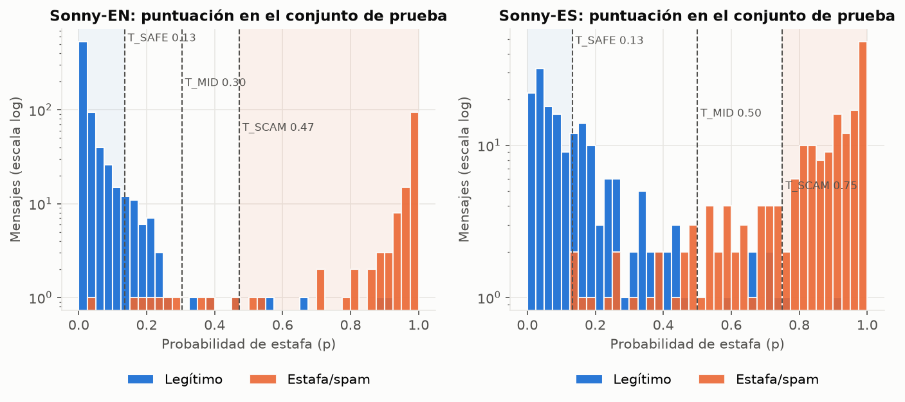 |

### Límites, con honestidad

- Casi no existen datos públicos de SMS de estafa en español, así que el modelo en español generaliza peor entre estilos de mensaje.
- La estafa del **"familiar en apuros"** ("Hola mamá, se me rompió el celular…") no se detecta sin internet en ninguno de los dos idiomas: ningún dataset público la incluye. Con internet, la segunda opinión de la IA revisa esos casos.
- Las métricas de prueba miden mensajes parecidos a los de entrenamiento. Con nuestra batería de 20 mensajes cotidianos y realistas, Sonny acierta **18 de 20**.

### Datasets (todos con licencia abierta)

| Dataset | Idioma | Licencia |
|---|---|---|
| [SMS Spam Collection](https://archive.ics.uci.edu/dataset/228/sms+spam+collection) (UCI) | EN | CC BY 4.0 |
| [SMS Phishing Dataset](https://data.mendeley.com/datasets/f45bkkt8pr/1), Mishra y Soni (Mendeley Data) | EN | CC BY 4.0 |
| [SpaPhish](https://data.mendeley.com/datasets/hz2d6gz7pc), Bustio-Martínez et al. (Mendeley Data) | ES | CC BY 4.0 |
| [softecapps/spam_ham_spanish](https://huggingface.co/datasets/softecapps/spam_ham_spanish) (Hugging Face), con 10 etiquetas corregidas | ES | Apache-2.0 |

Cambios hechos a los datos (lo exige CC BY 4.0): eliminación de duplicados, sustitución del carácter `U+FFFD`, recorte de los correos de SpaPhish y las correcciones de etiquetas listadas en [`modelo/data/manual/relabel_es.csv`](modelo/data/manual/relabel_es.csv).

---

## ✨ Funciones

- 🛑 ⚠️ ✅ **Veredicto tipo semáforo** en una frase grande, con los pasos de **"¿Qué hago ahora?"** y un camino de emergencia ("¿Ya diste tus datos?").
- 🔍 **"¿Por qué?"**: se resaltan las palabras que empujan hacia estafa o hacia normal, y se explican las reglas de los enlaces.
- 📷 **Fotos y capturas**: las lee la IA, o el propio equipo sin internet.
- 🌐 **Inglés y español**, y en español puedes elegir que te hable de *tú* o de *usted*.
- 📴 **Funciona sin internet**: el modelo propio y las reglas de enlaces corren en el equipo.
- 👵 **Pensado para personas mayores**: texto de 20 px, botones de 64 px, contraste AA, pantallas principales sin desplazarse, voz para leer en voz alta (opcional) y respeto por "reducir movimiento".
- 🌗 **Modo claro y oscuro**, diseño de computadora con menú arriba y diseño de celular con barra de pestañas abajo.
- 📊 **Página de resultados** con las métricas del modelo, gráficas y una **demo en vivo** donde puedes probar tú mismo el ataque de caracteres invisibles.

## 🛠️ Tecnologías

| Área | Tecnologías |
|---|---|
| App (web + Android) | Expo SDK 58, React Native 0.88, React 19, Expo Router, TypeScript, react-native-svg, Reanimated |
| Nuestro modelo | Python, scikit-learn (TF-IDF de n-gramas de caracteres + regresión logística), pandas, matplotlib; cálculo reescrito en TypeScript |
| Segunda opinión de IA | Google Gemini (con visión), llamado solo desde nuestro servidor; proveedor intercambiable y un proveedor simulado ("mock") para pruebas |
| OCR en el equipo | tesseract.js (web), Google ML Kit incluido en la APK (Android), Apple Vision (iOS) mediante expo-text-extractor |
| Validación | Zod (esquema de la API), pruebas de Node, unittest de Python |
| Compilación | EAS Build (APK de Android), exportación web de Expo con rutas de API |

---

## 🚀 Correrlo en tu computadora

**Requisitos:** Node.js 22.18 o superior y npm. Para reentrenar el modelo: Python 3.10 o superior.

### 1. La app (web)

```bash
git clone https://github.com/JkalasG/sonny.git
cd sonny/app
npm install
cp .env.example .env      # solo la primera vez
npm run web:mock          # IA simulada: no hace falta clave ni internet
```

Abre **http://localhost:8081**. En un celular conectado al mismo Wi-Fi, abre `http://<IP-de-tu-computadora>:8081`.

| Comando | IA que usa | Cuándo usarlo |
|---|---|---|
| `npm run web:mock` | Simulada | Demostraciones y pruebas, sin clave. El modelo propio funciona normal; solo la segunda opinión de la IA es simulada, y "¿Por qué?" lo indica |
| `npm run web` con `AI_PROVIDER=gemini` y `AI_API_KEY=…` en `.env` | Gemini de verdad | Uso normal. La clave se saca en https://aistudio.google.com/apikey |
| `npm run web` con `AI_API_KEY` vacía | Ninguna | Solo el modelo propio y las reglas de enlaces, como sin internet. Las fotos las lee el navegador |

> ⚡ En modo desarrollo cada página se compila la primera vez que la abres, por eso va más lento. Para ver la velocidad real:
> `npx expo export -p web && npx expo serve --port 8098`, y abre http://localhost:8098.

### 2. Variables de entorno (`app/.env`)

| Variable | Qué hace |
|---|---|
| `AI_PROVIDER` | `gemini` (IA de verdad) o `mock` (IA simulada para pruebas) |
| `AI_API_KEY` | Clave de Gemini. **Es secreta**: se queda en el servidor, nunca en la app |
| `AI_MODEL` | Modelo de Gemini (por defecto `gemini-3.8-flash`, con visión para leer fotos) |
| `AI_TIMEOUT_MS` | Tiempo máximo de espera a la IA (por defecto 14000 ms); después, Sonny decide solo |
| `RATE_LIMIT_PER_HOUR` | Análisis con IA por IP y por hora (por defecto 20) |
| `AI_MOCK_SCENARIO`, `AI_MOCK_DELAY_MS` | Solo con `mock`: comportamiento y demora de la IA simulada |
| `EXPO_PUBLIC_API_URL` | En la web, déjala vacía. En la APK: la URL del servidor publicado |

Más detalles en [`app/README.md`](app/README.md).

### 3. APK de Android

```bash
cd app
npx eas-cli@latest build -p android --profile preview
```

Necesitas una cuenta gratuita de Expo. El perfil `preview` genera una APK de 64 bits (`arm64-v8a`).

### 4. Reentrenar el modelo (opcional)

```bash
cd modelo
pip install -r requirements.txt
python 01_download.py && python 02_prepare.py && python 03_train.py
python 04_export.py --app ../app     # exporta los modelos y los copia a la app
python 06_analisis.py                # análisis completo + gráficas
npm test && npm run test:py          # 18 pruebas JS + 17 Python
```

### 5. Pruebas

```bash
cd app && npm test && npm run typecheck && npm run lint
cd modelo && npm test && npm run test:py
```

---

## 📁 Estructura del proyecto

```text
sonny/
├── app/                     # app de Expo (web + Android)
│   ├── src/app/             # pantallas (Expo Router) + api/analyze (servidor)
│   ├── src/lib/             # cascada, tabla de decisión, reglas de enlaces, OCR, ajustes, textos
│   ├── src/lib/sonny/       # cálculo del modelo en TypeScript (generado desde modelo/js)
│   ├── src/server/          # proveedores de IA: Gemini y el simulado
│   ├── assets/models/       # en.sonny, es.sonny, lang.sonny (nuestros modelos entrenados)
│   └── plugins/             # plugin de Expo que incluye el OCR de ML Kit en la APK
├── modelo/                  # nuestro pipeline de ML: datos, entrenamiento, exportación, análisis, pruebas
│   ├── ANALISIS_MODELO.md   # análisis completo del modelo (17 pruebas)
│   └── reports/             # métricas, batería realista, gráficas
├── docs/screenshots/        # imágenes para este README y Devpost
├── Sonny_Modelo_y_Arquitectura.md   # diseño de la arquitectura y del modelo
├── consideraciones.md               # experiencia para personas mayores, seguridad, privacidad
└── Sonny_Documentacion.md           # idea original
```

---

## 🏆 Criterios del jurado

| Criterio | Dónde verlo |
|---|---|
| **Innovación y creatividad** | Un "nieto cariñoso" en lugar de una herramienta de seguridad; una cascada que protege la privacidad, donde las estafas claras nunca salen del equipo; diseño para personas mayores |
| **Complejidad técnica** | Modelos propios entrenados (EN, ES e idioma) con resultados idénticos en Python y TypeScript; análisis de 17 pruebas; un ataque real encontrado y arreglado; OCR en el equipo en la web y en Android; IA detrás de un servidor con tabla de decisión |
| **Funcionamiento y ejecución** | Funciona en la web y en Android, con y sin internet, en modo claro y oscuro, en computadora y celular; pruebas automáticas en la app y en el modelo |
| **Presentación y claridad** | Video de demostración (ver Enlaces), este README y la página de resultados dentro de la app, con demo en vivo |

## 🔒 Privacidad y seguridad

- Las estafas claras se deciden en el equipo y **no se envían a ningún lado**.
- Los mensajes y fotos que se envían a la IA **no se guardan**.
- La clave de la IA vive solo en el servidor, con un límite de consultas por IP.
- Sonny puede equivocarse: la app siempre dice *"Ante la duda, llama siempre al número oficial."*

## 👥 Equipo

_Agrega aquí los nombres y enlaces de los integrantes (de 1 a 4)._

## 📄 Licencia

[MIT](LICENSE). Los datasets mantienen sus propias licencias (ver arriba). La carpeta `app/` partió de la plantilla de Expo, cuya licencia MIT se conserva en [`app/LICENSE`](app/LICENSE).
