<p align="center">
  
</p>

<p align="center"><b>The grandson who never leaves you alone against a scam.</b><br>
<i>Before you tap a strange message, ask Sonny.</i></p>

<p align="center">
  <a href="https://github.com/JkalasG/sonny/actions/workflows/ci.yml"></a>
  
  
  
  
</p>

<p align="center">
  🇬🇧 <b>English</b> · 🇪🇸 <a href="README.es.md">Leer en español</a>
</p>

<p align="center">
  <a href="#-run-it-locally">Run it locally</a> ·
  <a href="#-our-own-scam-detection-model">Our model</a> ·
  <a href="#-how-it-works">How it works</a> ·
  <a href="#-screenshots">Screenshots</a>
</p>

---

## 🔗 Links

| | |
|---|---|
| 🏆 **Devpost submission** | _add the Devpost link here_ |
| 🎥 **Demo video (2–5 min)** | _add the YouTube / Vimeo link here_ |
| 🌐 **Live web demo** | _add the deployed URL here (optional)_ |
| 📱 **Android APK** | _add the EAS build link here (optional)_ |
| 💻 **Source code** | https://github.com/JkalasG/sonny |

Built for **Next Byte Hacks V5** (Devpost) during the hackathon period, November 2026.

---

## 💡 What is Sonny?

**Sonny is a scam detector for older people and anyone with little digital experience.** You paste a suspicious message (SMS, WhatsApp, email) or upload a screenshot, and in seconds Sonny tells you:

- 🛑 **Scam** / ⚠️ **Suspicious** / ✅ **Looks normal**: a traffic-light verdict in one big sentence.
- **Why**: the suspicious words are highlighted inside the message, and fake links are explained.
- **What to do now**: simple steps, like "call your bank at the number on your card" or "call a family member".

Sonny talks like a patient, caring grandson ("You did well to ask me. That's what I'm here for."). It works in **English and Spanish**, uses large text and big buttons, and **works without internet**.

### The problem

Phishing and smishing messages imitate banks, delivery companies, government offices and even family members ("Hi mom, I broke my phone…"). Older adults are among the most frequent targets. They often have nobody to ask at that moment, and generic tools are either too technical or need an internet connection and send private messages to a server.

### Our approach

1. **Our own machine-learning model runs inside the phone or browser.** Clear scams are detected instantly and **never leave the device**.
2. Only when the model is unsure, and only if there is internet, Sonny asks an **AI for a second opinion** (Google Gemini). A decision table makes sure the AI can never turn a high-risk message into "looks normal".
3. **Link rules** catch fake domains (`paypa1.com`, `bank-verify.xyz`, URL shorteners, missing HTTPS).
4. **Photos are read on the device** (OCR). If the AI is not available, the browser (`tesseract.js`) or the phone (Google ML Kit, bundled in the APK) turns the image into text.

---

## ⚡ Quick Judge Demo (Test in 10 Seconds without Typing)

If you are a hackathon judge evaluating Sonny:
1. Open the app (or run `npm run web` inside `app/`).
2. Navigate to **Examples** (or tap the sample message chips right on the home screen).
3. Tap **"Fake Bank Alert"** or **"Package on Hold"**: Sonny catches the scam in **~0.1 ms on-device**, highlights dangerous words, and explains fake domains.
4. Tap **"Legitimate Bank Code"** or **"Family Dinner"**: See how Sonny prevents false positives on actual bank security 2FA codes.
5. **Offline Test:** Turn on Airplane Mode or disconnect WiFi. Sonny continues to analyze messages offline with full privacy.

---

## 📸 Screenshots

| Home (desktop) | Scam verdict |
|---|---|
| 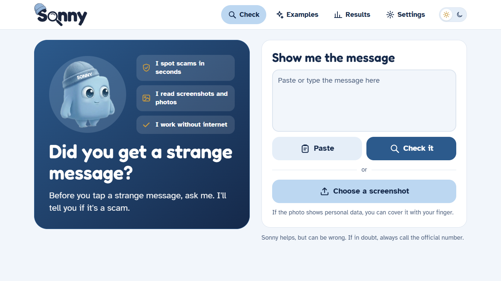 | 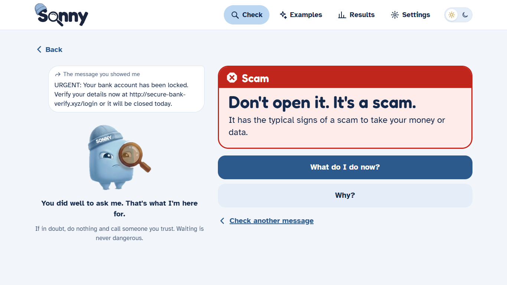 |
| **"Why?": highlighted words and link rules** | **Model results page, with a live demo** |
| 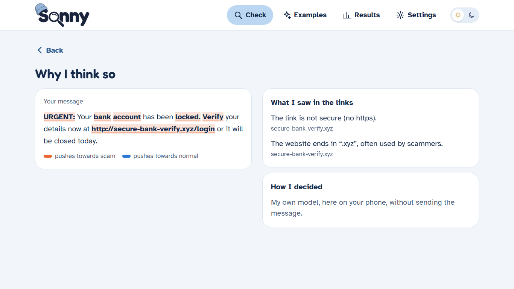 | 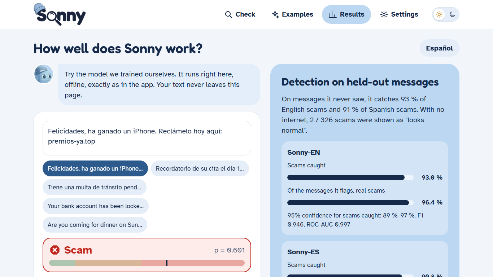 |
| **Dark mode** | **On the phone** |
| 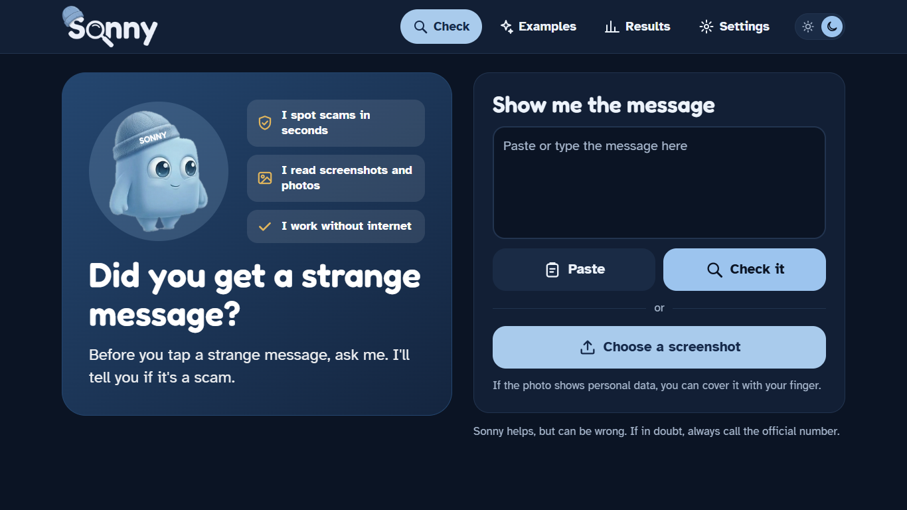 | 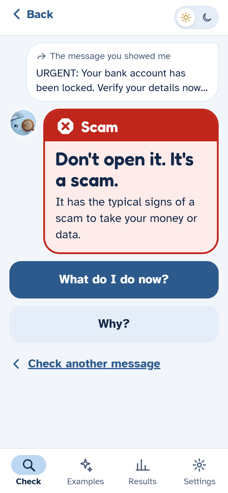 |

---

## 🔄 How it works

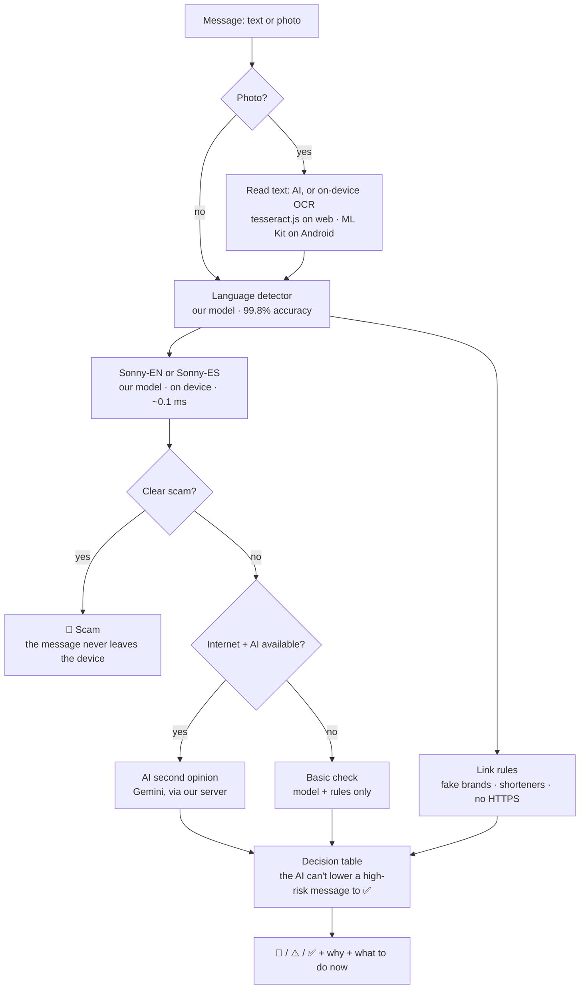

- **The AI key never reaches the phone.** The app calls our own endpoint (`/api/analyze`), which holds the key and has a rate limit.
- **No message or photo is stored.** It is processed and discarded.
- If the AI is slow (more than 14 s) or fails, Sonny answers with its own model.

---

## 🧠 Our own scam-detection model

The core of Sonny is **not** a call to an AI API. We **trained our own classifiers** in Python, exported them to JSON, and re-implemented the scoring in TypeScript so it runs in the app, offline. The full work is in [`modelo/`](modelo/).

### What we built

| Step | What we did | Code |
|---|---|---|
| 1. Data | Joined 4 public datasets (English and Spanish), cleaned them, removed duplicates and **corrected 10 wrong labels by hand** | [`01_download.py`](modelo/01_download.py), [`02_prepare.py`](modelo/02_prepare.py) |
| 2. Model | Character n-grams (TF-IDF) + logistic regression, one model per language, plus a language detector | [`03_train.py`](modelo/03_train.py) |
| 3. Thresholds | Three cut-off points (safe / suspicious / scam) chosen with 5-fold cross-validation, **without looking at the test set** | [`03_train.py`](modelo/03_train.py) |
| 4. Export | Models exported to `.sonny` (JSON, 0.8 MB each) and scored in TypeScript **with exactly the same result as Python** | [`04_export.py`](modelo/04_export.py), [`js/scorer.ts`](modelo/js/scorer.ts) |
| 5. Evaluation | 17 different analyses: confidence intervals, baselines, calibration, robustness, error analysis… | [`06_analisis.py`](modelo/06_analisis.py), [`ANALISIS_MODELO.md`](modelo/ANALISIS_MODELO.md) |
| 6. Tests | 18 JS tests (parity with Python, behavior), 17 Python tests with quality gates, 9 app tests | `npm test`, `npm run test:py` |

### Results (held-out test set, 15% of the data)

| Model | Messages | Precision | Recall (scams caught) | F1 | ROC-AUC |
|---|---|---|---|---|---|
| **Sonny-EN** | 5,981 | 96.4% | 93.0% | 0.946 | 0.997 |
| **Sonny-ES** | 2,384 | 95.4% | 90.8% | 0.930 | 0.978 |
| **Language detector** | 8,365 | accuracy 99.8% | | | |

Offline, only **0.7% (EN) and 0.5% (ES) of scams** would be shown as "looks normal". The rest are flagged 🛑 or ⚠️.

### Why this model and not another one?

| Method | F1 EN | F1 ES |
|---|---|---|
| Keyword list (our first idea) | 0.610 | 0.571 |
| Character n-grams + Naive Bayes | 0.881 | 0.877 |
| Word TF-IDF + logistic regression | 0.926 | 0.930 |
| **Sonny: character n-grams + logistic regression** | **0.946** | **0.930** |

Character n-grams are also **more robust to typos** (with 30% of words misspelled, recall stays at 92.3% EN vs 88.0% for the word model).

### A real attack we found and fixed

Our robustness tests applied 10 transformations to every test message (ALL CAPS, no accents, emojis, typos, l33t…). They revealed that **inserting invisible Unicode characters** (`U+200B`, `U+200C`) inside words dropped the Spanish model's recall from **92% to 57%**. The model had even learned that `U+200C` meant "legitimate", because it appears in real marketing emails. We fixed the preprocessing, and the attack now has **zero effect**.

### Charts

| | |
|---|---|
| 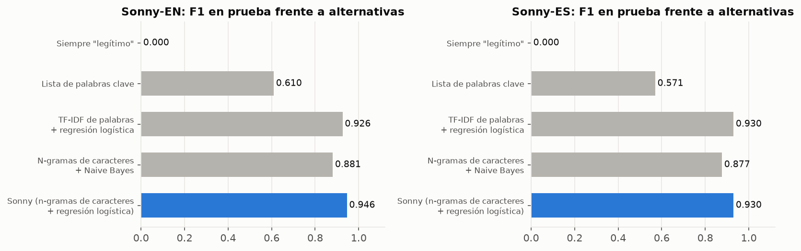 | 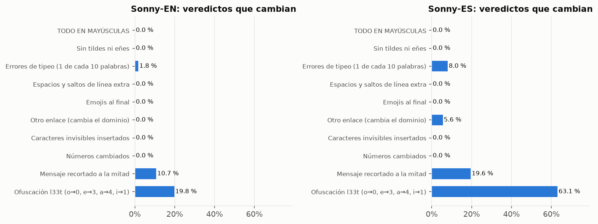 |
| 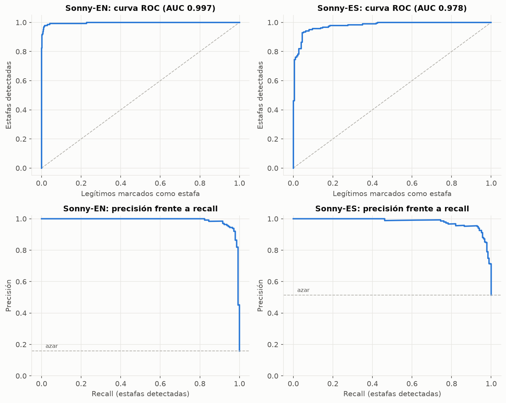 | 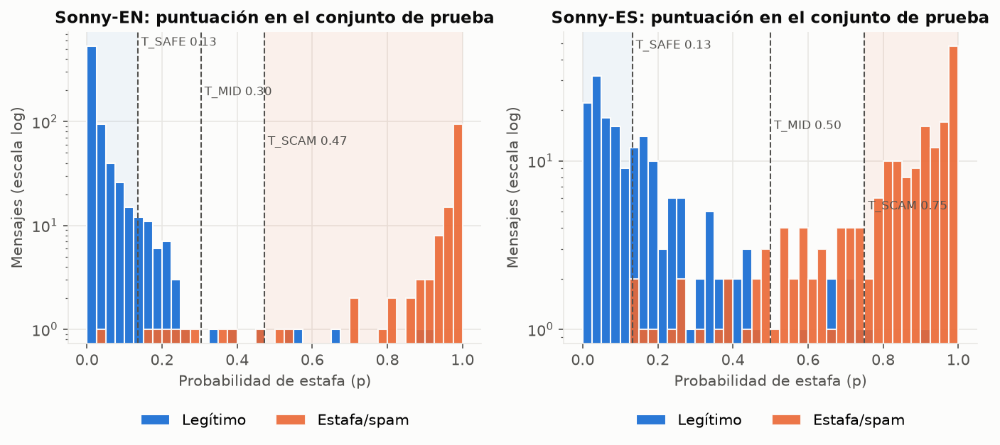 |

### Honest limitations

- Public Spanish SMS scam data barely exists, so the Spanish model generalizes less well between message styles.
- The **"family member in trouble"** scam ("Hi mom, I broke my phone…") is missed offline in both languages: no public dataset includes it. With internet, the AI second opinion reviews those cases.
- Test metrics measure messages similar to the training data. Our realistic battery of 20 everyday messages scores **18/20**.

### Datasets (all with open licenses)

| Dataset | Language | License |
|---|---|---|
| [SMS Spam Collection](https://archive.ics.uci.edu/dataset/228/sms+spam+collection) (UCI) | EN | CC BY 4.0 |
| [SMS Phishing Dataset](https://data.mendeley.com/datasets/f45bkkt8pr/1), Mishra & Soni (Mendeley Data) | EN | CC BY 4.0 |
| [SpaPhish](https://data.mendeley.com/datasets/hz2d6gz7pc), Bustio-Martínez et al. (Mendeley Data) | ES | CC BY 4.0 |
| [softecapps/spam_ham_spanish](https://huggingface.co/datasets/softecapps/spam_ham_spanish) (Hugging Face), with 10 labels corrected | ES | Apache-2.0 |

Changes made to the data (required by CC BY 4.0): duplicates removed, the `U+FFFD` character replaced, SpaPhish emails trimmed, and the label corrections listed in [`modelo/data/manual/relabel_es.csv`](modelo/data/manual/relabel_es.csv).

---

## ✨ Features

- 🛑 ⚠️ ✅ **Traffic-light verdict** in one big sentence, with **"What do I do now?"** steps and an emergency path ("Did you already give your details?").
- 🔍 **"Why?"**: words that push towards scam or normal are highlighted, and link rules are explained.
- 📷 **Photos and screenshots**: read by the AI, or on the device without internet.
- 🌐 **English and Spanish**, with *tú* or *usted* in Spanish.
- 📴 **Works offline**: our model and link rules run on the device.
- 👵 **Designed for older people**: body text 20 px, 64 px buttons, AA contrast, no scrolling on the main screens, optional read-aloud voice, "reduce motion" respected.
- 🌗 **Light and dark mode**, desktop layout with a top menu, phone layout with a bottom tab bar.
- 📊 **Results page** with the model's metrics, charts and a **live demo** where you can try the invisible-character attack yourself.

## 🛠️ Technologies

| Area | Technologies |
|---|---|
| App (web + Android) | Expo SDK 58, React Native 0.88, React 19, Expo Router, TypeScript, react-native-svg, Reanimated |
| Our ML model | Python, scikit-learn (TF-IDF character n-grams + logistic regression), pandas, matplotlib; scoring re-implemented in TypeScript |
| AI second opinion | Google Gemini (with vision), called only from our server endpoint; swappable provider and a simulated "mock" provider for testing |
| On-device OCR | tesseract.js (web), Google ML Kit bundled in the APK (Android), Apple Vision (iOS) via expo-text-extractor |
| Validation | Zod (API schema), Node test runner, Python unittest |
| Build | EAS Build (Android APK), Expo web export with API routes |

---

## 🚀 Run it locally

**Requirements:** Node.js 22.18 or newer, npm. For retraining the model: Python 3.10 or newer.

### 1. The app (web)

```bash
git clone https://github.com/JkalasG/sonny.git
cd sonny/app
npm install
cp .env.example .env      # only the first time
npm run web:mock          # simulated AI: no key or internet needed
```

Open **http://localhost:8081**. On a phone on the same Wi-Fi, open `http://<your-computer-IP>:8081`.

| Command | AI used | When to use it |
|---|---|---|
| `npm run web:mock` | Simulated | Demos and testing, without a key. Our model works normally; only the AI second opinion is simulated, and "Why?" says so |
| `npm run web` with `AI_PROVIDER=gemini` and `AI_API_KEY=…` in `.env` | Real Gemini | Normal use. Get a key at https://aistudio.google.com/apikey |
| `npm run web` with an empty `AI_API_KEY` | None | Our model + link rules only, as if offline. Photos are read by the browser |

> ⚡ Development mode compiles each page the first time you open it, so it is slower. To see the real speed:
> `npx expo export -p web && npx expo serve --port 8098`, then open http://localhost:8098.

### 2. Environment variables (`app/.env`)

| Variable | What it does |
|---|---|
| `AI_PROVIDER` | `gemini` (real AI) or `mock` (simulated AI for testing) |
| `AI_API_KEY` | Gemini key. **Secret**: it stays on the server, never in the app |
| `AI_MODEL` | Gemini model (default `gemini-3.8-flash`, with vision for photos) |
| `AI_TIMEOUT_MS` | Maximum wait for the AI (default 14000 ms); after that, Sonny decides alone |
| `RATE_LIMIT_PER_HOUR` | AI analyses per IP per hour (default 20) |
| `AI_MOCK_SCENARIO`, `AI_MOCK_DELAY_MS` | Only with `mock`: behavior and delay of the simulated AI |
| `EXPO_PUBLIC_API_URL` | Leave empty on the web. In the APK: the URL of the deployed server |

More details: [`app/README.md`](app/README.md).

### 3. Android APK

```bash
cd app
npx eas-cli@latest build -p android --profile preview
```

Needs a free Expo account. The `preview` profile builds a 64-bit (`arm64-v8a`) APK.

### 4. Retrain the model (optional)

```bash
cd modelo
pip install -r requirements.txt
python 01_download.py && python 02_prepare.py && python 03_train.py
python 04_export.py --app ../app     # exports the models and copies them into the app
python 06_analisis.py                # full analysis + charts
npm test && npm run test:py          # 18 JS + 17 Python tests
```

### 5. Tests

```bash
cd app && npm test && npm run typecheck && npm run lint
cd modelo && npm test && npm run test:py
```

---

## 📁 Project structure

```text
sonny/
├── app/                     # Expo app (web + Android)
│   ├── src/app/             # screens (Expo Router) + api/analyze (server endpoint)
│   ├── src/lib/             # cascade, decision table, link rules, OCR, settings, i18n
│   ├── src/lib/sonny/       # model scoring in TypeScript (generated from modelo/js)
│   ├── src/server/          # AI providers: Gemini and the simulated one
│   ├── assets/models/       # en.sonny, es.sonny, lang.sonny (our trained models)
│   └── plugins/             # Expo plugin that bundles ML Kit OCR into the APK
├── modelo/                  # our ML pipeline: data, training, export, analysis, tests
│   ├── ANALISIS_MODELO.md   # full model analysis (17 tests)
│   └── reports/             # metrics, realistic battery, charts
├── docs/screenshots/        # images for this README and Devpost
├── Sonny_Modelo_y_Arquitectura.md   # architecture and model design (Spanish)
├── consideraciones.md               # UX for older people, safety, privacy (Spanish)
└── Sonny_Documentacion.md           # original idea (Spanish)
```

---

## 🏆 Hackathon judging criteria

| Criterion | Where to look |
|---|---|
| **Innovation & Creativity** | A "caring grandson" instead of a security tool; privacy-first cascade where clear scams never leave the device; design for older people |
| **Technical Complexity** | Our own trained models (EN, ES, language) with Python ↔ TypeScript parity; 17-test analysis; a real attack found and fixed; on-device OCR on web and Android; AI behind a server endpoint with a decision table |
| **Functionality & Execution** | Works on web and Android, online and offline, light and dark mode, desktop and phone layouts; automated tests in the app and the model |
| **Presentation & Clarity** | Demo video (see Links), this README, the in-app results page with a live demo |

## 🔒 Privacy and safety

- Clear scams are decided on the device and **never sent anywhere**.
- Messages and photos sent to the AI are **not stored**.
- The AI key lives only on the server, with a per-IP rate limit.
- Sonny can be wrong: the app always says *"If in doubt, always call the official number."*

## 👥 Team

_Add the team members' names and links here (1–4 members)._

## 📄 License

[MIT](LICENSE). Datasets keep their own licenses (see above). The `app/` folder started from the Expo template, whose MIT license is kept in [`app/LICENSE`](app/LICENSE).
