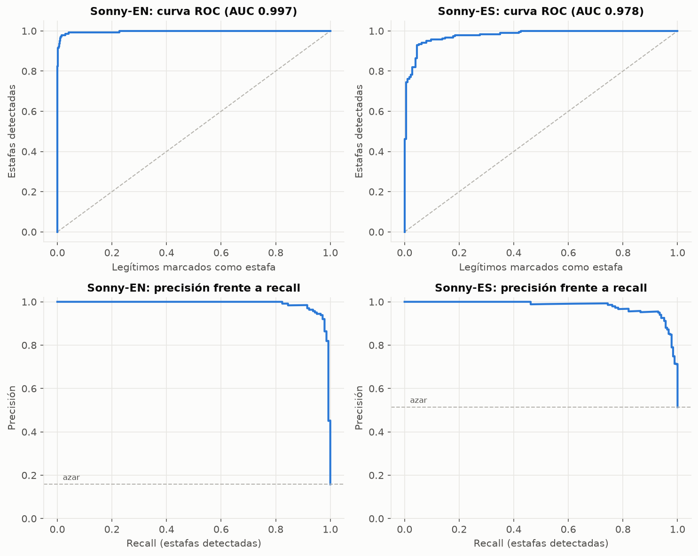
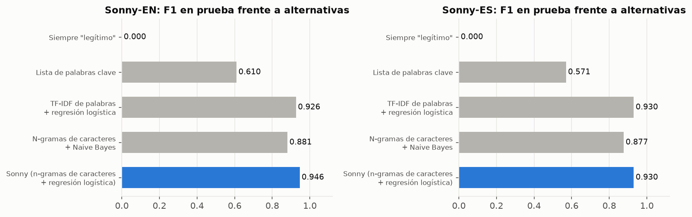
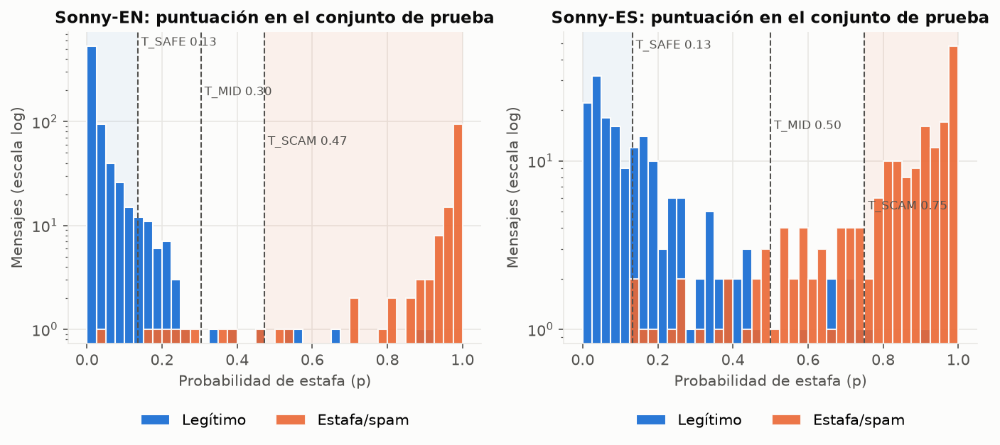
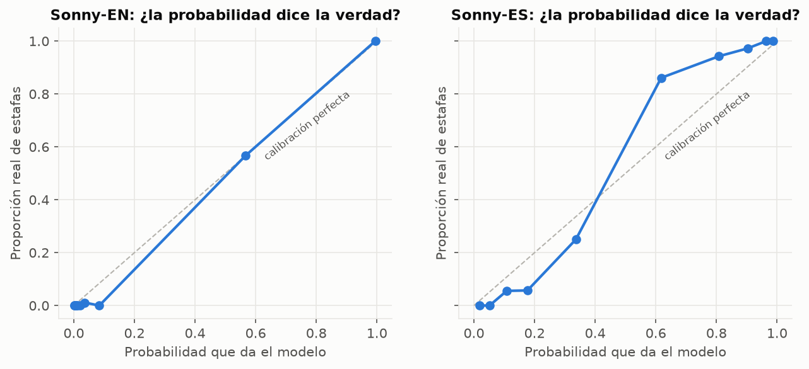
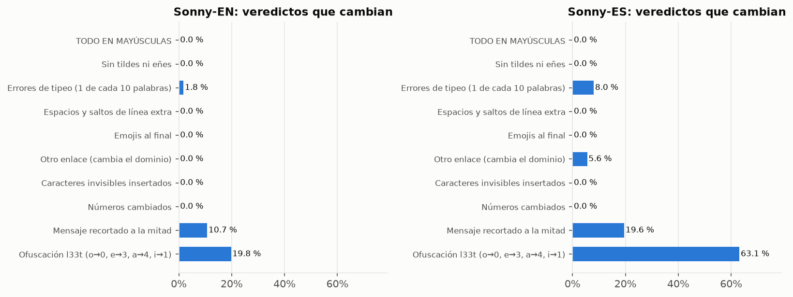
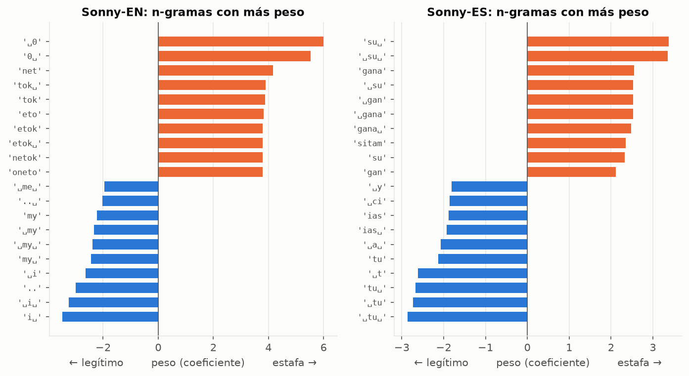
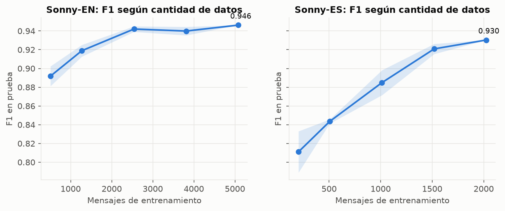

# Sonny — Análisis completo del modelo

> Qué tan bien funcionan los modelos propios de Sonny, cómo lo probamos, qué encontramos (incluido un ataque que descubrimos y arreglamos) y cómo demostrarlo en el hackathon.
>
> Cifras del **7 de noviembre de 2026**. Se regeneran con `npm run all` desde `modelo/`. El detalle completo, con todas las tablas, está en [`reports/analisis.md`](reports/analisis.md).

---

## Índice

0. [Resumen en 30 segundos](#0-resumen-en-30-segundos)
1. [Las pruebas que hicimos](#1-las-pruebas-que-hicimos)
2. [¿Qué tan bien detecta estafas?](#2-qué-tan-bien-detecta-estafas)
3. [¿Por qué este modelo y no otro?](#3-por-qué-este-modelo-y-no-otro)
4. [Cómo decide la cascada](#4-cómo-decide-la-cascada)
5. [¿Se puede confiar en la probabilidad?](#5-se-puede-confiar-en-la-probabilidad)
6. [Robustez: el ataque que encontramos y arreglamos](#6-robustez-el-ataque-que-encontramos-y-arreglamos)
7. [Qué aprendió el modelo (explicabilidad)](#7-qué-aprendió-el-modelo-explicabilidad)
8. [Límites, contados con honestidad](#8-límites-contados-con-honestidad)
9. [Velocidad y tamaño en el celular](#9-velocidad-y-tamaño-en-el-celular)
10. [Guion de demostración para el hackathon](#10-guion-de-demostración-para-el-hackathon)
11. [Preguntas probables del jurado](#11-preguntas-probables-del-jurado)
12. [Próximos pasos](#12-próximos-pasos)

---

## 0. Resumen en 30 segundos

- **Dos modelos propios**, entrenados por el equipo, uno para inglés y otro para español, más un detector de idioma. Funcionan **dentro del celular y sin internet**.
- En mensajes que no vieron al entrenar detectan el **93 % (EN) y el 91 % (ES) de las estafas**, con una precisión del **96 % y del 95 %** (F1 0,946 y 0,930).
- Sin internet, solo **el 0,7 % (EN) y el 0,5 % (ES) de las estafas** saldrían como "parece normal". El resto sale 🛑 o ⚠️.
- Superan a la lista de palabras clave (F1 0,61 / 0,57) y a Naive Bayes (0,88 / 0,88). Frente a TF-IDF de palabras ganan en inglés (0,946 frente a 0,926) y empatan en español (0,930), pero aguantan mejor los errores de tipeo.
- Las pruebas de robustez **descubrieron un ataque real**: insertando caracteres invisibles, el recall del modelo ES caía del 92 % al **57 %**. Lo arreglamos y ahora el ataque **no tiene efecto** (0 % de cambios).
- **Límite principal:** el modelo ES no generaliza entre estilos de mensaje, y la estafa del **"familiar en apuros"** sale como normal sin internet. Ningún dataset público la incluye; la solución es recopilar mensajes reales. Con internet, la IA externa revisa esos casos.
- Cada análisis tarda **~0,1 ms** en JavaScript y cada modelo pesa **0,8 MB**.

### Summary for Devpost (English)

> Sonny runs **two models we trained ourselves** (English and Spanish) plus a language detector, **on the device and offline**. On held-out test data they catch **93% (EN) and 91% (ES) of scams** at **96% / 95% precision**, and offline only **0.7% / 0.5% of scams** would be shown as "looks normal". They clearly beat keyword rules and Naive Bayes, match or beat word-level TF-IDF while being more robust to typos, and stay stable under typos, ALL CAPS, missing accents and emojis. Our robustness tests **found a real evasion attack**: inserting invisible Unicode characters dropped Spanish recall from 92% to 57%. We fixed it in preprocessing and the attack now has **zero effect**. Honest limitation: public Spanish SMS scam data barely exists, and the "family member in trouble" scam is missed offline. When online, an independent AI second opinion reviews every message except obvious scams, which never leave the phone. Scoring takes **~0.1 ms** per message; each model is **0.8 MB**.

---

## 1. Las pruebas que hicimos

| # | Prueba | Qué responde | Dónde | Resultado |
|---|---|---|---|---|
| 1 | Métricas en prueba con intervalo de confianza | ¿Qué tan bien detecta, con qué margen de error? | `03_train.py`, `06_analisis.py` §2 | F1 0,946 (EN) / 0,930 (ES) |
| 2 | Comparación con 4 alternativas | ¿Hacía falta este modelo? | §5 | Sonny es el mejor o empata en los dos idiomas |
| 3 | Tabla de umbrales | ¿Qué pasa si movemos el corte? | §3 | Umbrales elegidos sin mirar la prueba |
| 4 | Calibración | ¿"p = 0,8" significa 80 %? | §4 | Brier 0,013 (EN) / 0,062 (ES) |
| 5 | Curva de aprendizaje | ¿Más datos ayudarían? | §6 | ES sí (sigue subiendo); EN casi se estabiliza |
| 6 | Generalización entre fuentes | ¿Funciona con un estilo de mensaje que no vio? | §7 | EN sí; **ES no** |
| 7 | Cruce de idiomas | ¿Hacen falta dos modelos? | §8 | Sí: un modelo con el otro idioma acierta como el azar |
| 8 | Robustez (10 transformaciones) | ¿Se engaña fácil? | §9 | Inmune a mayúsculas, tildes, emojis, espacios, invisibles |
| 9 | Palabras frente a caracteres | ¿Por qué n-gramas de caracteres? | §9 | Más robusto con errores de tipeo |
| 10 | Análisis de errores | ¿En qué se equivoca? | §10 | Ruido de etiquetas y mensajes bancarios reales |
| 11 | Explicabilidad | ¿En qué se fija? | §11 | Encontramos un atajo tú/usted (ver 7) |
| 12 | Detector de idioma | ¿Elige bien el modelo? | §12 | 99,8 %; ante la duda usa el idioma del usuario |
| 13 | Simulación de la cascada | ¿Qué se queda en el celular? | §13 | 15 % (EN) / 39 % (ES) nunca salen del celular |
| 14 | Batería realista | ¿Y con mensajes como los de una abuela? | §14, `05_bateria.py` | 18/20 |
| 15 | Velocidad y tamaño | ¿Cabe y va rápido en un celular? | §15, `js/bench.ts` | ~0,1 ms, 0,8 MB |
| 16 | Pruebas automáticas JS | ¿La app calcula exactamente lo mismo? | `npm test` | **18/18** |
| 17 | Pruebas automáticas Python + barreras de calidad | ¿Un reentrenamiento empeoró algo? | `npm run test:py` | **17/17** |

**Reproducir todo** (desde `modelo/`, unos 3 minutos):

```bash
npm run all        # prepara, entrena, exporta, batería, análisis y las 35 pruebas automáticas
```

**Regla de oro de la evaluación:** los umbrales y el valor de `C` se eligen con validación cruzada sobre el 85 % `dev`. El 15 % de prueba **no se usa para decidir nada**; solo se mira al final.

---

## 2. ¿Qué tan bien detecta estafas?

Conjunto de prueba: 898 mensajes en inglés y 358 en español que el modelo nunca vio. Umbral 0,5. Entre paréntesis, el intervalo de confianza del 95 % (bootstrap de 1.000 remuestreos).

| Modelo | Precisión | Recall (estafas detectadas) | F1 | ROC-AUC |
|---|---|---|---|---|
| **Sonny-EN** | 96,4 % (92,9–99,2) | 93,0 % (88,5–97,0) | 0,946 (0,918–0,971) | 0,997 |
| **Sonny-ES** | 95,4 % (92,0–97,9) | 90,8 % (86,3–94,4) | 0,930 (0,901–0,954) | 0,978 |

Cómo leerlo:
- **Precisión 95 %:** de cada 100 mensajes que Sonny marca como estafa, 95 lo son.
- **Recall 91–93 %:** de cada 100 estafas, Sonny detecta 91–93 con el umbral 0,5. En la cascada casi todas las demás salen ⚠️, no ✅ (sección 4).
- **ROC-AUC 0,98–0,997:** casi siempre puntúa más alto una estafa que un mensaje normal.



---

## 3. ¿Por qué este modelo y no otro?

Las mismas divisiones de datos con cinco métodos:

| Método | F1 EN | F1 ES | Recall EN | Recall ES |
|---|---|---|---|---|
| Siempre "legítimo" (no hacer nada) | 0,000 | 0,000 | 0 % | 0 % |
| Lista de palabras clave (la idea original de `consideraciones.md` 8.4) | 0,610 | 0,571 | 63 % | 51 % |
| N-gramas de caracteres + Naive Bayes | 0,881 | 0,877 | 81 % | 85 % |
| TF-IDF de palabras + regresión logística | 0,926 | 0,930 | 93 % | 91 % |
| **Sonny: n-gramas de caracteres + regresión logística** | **0,946** | **0,930** | **93 %** | **91 %** |



- **La lista de palabras clave falla una de cada dos estafas en español.** Esto confirma que eliminarla (documento de arquitectura, sección 14) fue correcto.
- **En español, Sonny empata con TF-IDF de palabras** en F1. Para elegir entre los dos medimos qué pasa con errores de tipeo, muy comunes en las estafas:

| Recall de estafas | Palabras EN | **Sonny EN** | Palabras ES | **Sonny ES** |
|---|---|---|---|---|
| Sin cambios | 93,0 % | 93,0 % | 90,8 % | 90,8 % |
| Tipeo en 30 % de las palabras | 88,0 % | **92,3 %** | 88,0 % | **90,2 %** |
| Ofuscación l33t | 78,2 % | **85,9 %** | **67,9 %** | 62,0 % |

Con errores de tipeo fuertes, los n-gramas de caracteres pierden mucho menos ("verifique", "verifiqeu" y "verificar" comparten trozos). Con l33t el resultado es mixto (sección 6).

---

## 4. Cómo decide la cascada

El modelo da una probabilidad `p`. Tres umbrales, calculados con validación cruzada (nunca con la prueba), la convierten en un veredicto:

| | `T_SAFE` | `T_MID` | `T_SCAM` | Cómo se eligió |
|---|---|---|---|---|
| Sonny-EN | 0,135 | 0,304 | 0,472 | `T_SCAM`: precisión ≥ 97 %. `T_SAFE`: como máximo el 1 % de las estafas por debajo |
| Sonny-ES | 0,132 | 0,500 | 0,750 | Ídem |



Los legítimos (azul) se amontonan a la izquierda y las estafas (naranja) a la derecha. La zona del medio es la que se consulta a la IA.

**Sin internet** (conjunto de prueba):

| Modelo | Realidad | 🛑 Estafa | ⚠️ Dudoso | ✅ Parece normal |
|---|---|---|---|---|
| Sonny-EN | Estafa/spam (142) | 132 | 9 | **1** |
| Sonny-EN | Legítimo (756) | **5** | 37 | 714 |
| Sonny-ES | Estafa/spam (184) | 138 | 45 | **1** |
| Sonny-ES | Legítimo (174) | **2** | 71 | 101 |

- **De 326 estafas, solo 2 saldrían como "parece normal"** sin internet.
- **Solo 7 de 930 mensajes legítimos salen 🛑.** El error más común es "⚠️ dudoso", que no asusta: el consejo es "pregunta antes de hacer nada".
- **Con internet:** el 15 % (EN) y el 39 % (ES) de los mensajes son estafas tan claras que **nunca salen del celular**. El resto recibe la segunda opinión de la IA.

---

## 5. ¿Se puede confiar en la probabilidad?



- **Sonny-EN** está casi sobre la diagonal (Brier 0,013): cuando dice 80 %, es estafa cerca del 80 % de las veces.
- **Sonny-ES** tiene forma de "S" (Brier 0,062): es **más prudente de lo necesario** en el medio. Con p ≈ 0,6, en realidad el 86 % son estafas; con p ≈ 0,35, el 25 %.
- **Consecuencia práctica:** por eso **no mostramos el porcentaje** al usuario (`consideraciones.md` 2.2) y decidimos con umbrales calibrados con datos, no con "0,5" a ojo.

---

## 6. Robustez: el ataque que encontramos y arreglamos

Aplicamos 10 transformaciones a todos los mensajes de prueba y medimos cuántos veredictos cambian:



| Transformación | Cambian EN | Cambian ES | Por qué |
|---|---|---|---|
| TODO EN MAYÚSCULAS | 0 % | 0 % | El preprocesado pasa todo a minúsculas |
| Sin tildes ni eñes | 0 % | 0 % | Se quitan las tildes antes de analizar |
| Espacios y saltos de línea extra | 0 % | 0 % | Se normalizan |
| Emojis al final | 0 % | 0 % | No están en el vocabulario |
| Números cambiados | 0 % | 0 % | Todo número pasa a `0`; los teléfonos a `phonetok` |
| **Caracteres invisibles insertados** | **0 %** | **0 %** | **Arreglado tras esta prueba** (ver abajo) |
| Otro enlace (cambia el dominio) | 0 % | 5,6 % | El enlace pasa a `urltok`; el dominio lo juzgan las reglas F5 |
| Errores de tipeo (1 de cada 10 palabras) | 1,8 % | 8,0 % | El recall no baja (EN 93 → 93 %, ES 91 → 92 %) |
| Mensaje recortado a la mitad | 10,7 % | 19,6 % | Con menos texto hay menos pistas. EN: 15 estafas pasan a ✅ |
| Ofuscación l33t (o→0, e→3…) | 19,8 % | 63,1 % | Debilidad conocida. ES: el recall baja al 62 %, pero ninguna estafa pasa a ✅ |

### El ataque de los caracteres invisibles

Algunos estafadores meten caracteres Unicode invisibles (espacios de ancho cero `U+200B`, `U+200C`…) dentro de las palabras para esquivar filtros. Para una persona el mensaje se ve igual; para un modelo, "ver‌ifique" ya no es "verifique".

Lo probamos y descubrimos que el modelo español era **muy vulnerable**. Además, había **aprendido** que el carácter `U+200C` indicaba "legítimo", porque aparece en los correos de marketing reales de SpaPhish. Un estafador que lo insertara ganaba dos veces.

| Modelo | Recall sin ataque | Con ataque, **antes** del arreglo | Con ataque, **después** |
|---|---|---|---|
| Sonny-EN | 93,0 % | 89,4 % | **93,0 %** |
| Sonny-ES | 92,4 % | **57,1 %** | **90,8 %** |

**Arreglo:** el preprocesado elimina ahora todos los caracteres de formato Unicode (categoría `Cf`) en Python y en JavaScript, y hay pruebas automáticas que lo vigilan. Sin ese atajo, el F1 de ES en prueba pasó de 0,942 a 0,930 (dentro del intervalo de confianza). Preferimos un modelo un poco menos "brillante" en la tabla pero que no se pueda engañar así.

---

## 7. Qué aprendió el modelo (explicabilidad)

Como es una regresión logística, se puede ver exactamente cuánto empuja cada trozo de texto. `␣` es el borde de una palabra.



- **Sonny-EN** se fija en `phonetok` (números de teléfono largos, típicos de premios por SMS) y en números (`␣0`). Hacia "legítimo" pesan `i`, `my`, `..` y `:)`, es decir, el estilo personal de un mensaje entre amigos. Es razonable.
- **Sonny-ES** se fija en `gana` (premios, dinero fácil) y en **`su` frente a `tu`**: "su" empuja hacia estafa y "tu" hacia legítimo.

> ⚠️ **Esto es un atajo, no una regla real.** En los datos, los correos de phishing de SpaPhish tratan de *usted* y los mensajes normales de softecapps tratan de *tú*. Por eso el **"Hola mamá, se me rompió el celular…" (de tú) sale como normal**, y un banco legítimo que trate de *usted* puede salir ⚠️. Para quitar el atajo hacen falta estafas reales de tú y mensajes legítimos reales de usted (sección 12).

---

## 8. Límites, contados con honestidad

**1. El modelo español no generaliza entre estilos.** Si se entrena solo con SMS cortos (softecapps) y se prueba con correos (SpaPhish), o al revés, acierta como el azar (ROC-AUC 0,51–0,54). En inglés sí generaliza: de la UCI a Mishra y Soni da AUC 0,997. Conclusión: el modelo ES funciona bien con mensajes **parecidos** a sus datos, y los SMS y WhatsApp reales de Bolivia y Latinoamérica no son ni plantillas ni correos.

**2. Más datos en español ayudarían, y mucho.** La curva de aprendizaje de ES sigue subiendo con fuerza (F1 0,81 con 200 mensajes, 0,93 con 2.026). La de EN casi se estabiliza (0,942 → 0,946 entre 2.500 y 5.000 mensajes).



**3. Hacen falta dos modelos.** El modelo EN con mensajes en español da AUC 0,55, y el ES con mensajes en inglés, 0,49: los dos aciertan como el azar con el otro idioma. Por eso existe el detector de idioma (99,8 % de exactitud). Ante un mensaje dudoso ("hola", "Call me cuando puedas"), el detector no elige y se usa el idioma del usuario.

**4. "Familiar en apuros" sale como normal** (p = 0,13 en ES y 0,11 en EN). Ningún dataset público trae este tipo de estafa. **Con internet** la IA lo revisa igual, porque la cascada solo se salta la IA cuando `p ≥ T_SCAM`. **Sin internet es el riesgo más grave.**

**5. Ruido en las etiquetas.** La SMS Spam Collection marca como "spam" chistes en cadena ("Do you realize that in about 40 years…"), y softecapps marca como spam la publicidad. El modelo aprende "no deseado", no solo "estafa".

**6. Falsos positivos con mensajes bancarios reales.** El legítimo con la puntuación más alta en EN es una notificación de transferencia bancaria (p = 0,92). Por eso el consejo de Sonny nunca es "ignóralo", sino "llama al número oficial", que es correcto en los dos casos.

**7. Ofuscación l33t y mensajes recortados.** Son las dos transformaciones que más cambian los veredictos (sección 6). Sin internet son una debilidad; con internet, la IA ve el mensaje completo.

---

## 9. Velocidad y tamaño en el celular

Medido con `node js/bench.ts` (Node 24, el mismo código que usará la app):

| Archivo | Tamaño | Cargar | Analizar un mensaje (mediana) |
|---|---|---|---|
| `en.sonny` | 0,83 MB | 16 ms | 0,13 ms |
| `es.sonny` | 0,82 MB | 13 ms | 0,06 ms |
| `lang.sonny` | 0,14 MB | 2 ms | 0,08 ms |

Los tiempos varían un poco entre ejecuciones.

Un análisis completo (detector de idioma + modelo) tarda **menos de medio milisegundo** en una computadora. En un celular de gama media cabe esperar del orden de 10 veces más (estimación sin medir), es decir, unos pocos milisegundos: **instantáneo** para el usuario. Toda la app añade unos 1,8 MB.

---

## 10. Guion de demostración para el hackathon

**Duración:** 2 minutos. **Preparación:** el celular en **modo avión** (para demostrar que funciona sin internet) y este documento abierto en las secciones 3 y 6.

| Tiempo | Qué hacer | Qué decir |
|---|---|---|
| 0:00 | Poner el celular en modo avión delante del jurado | *"Sonny works with no internet. These are two models we trained ourselves, running on the phone."* |
| 0:15 | Pegar: **"Felicidades, ha ganado un iPhone. Reclámelo hoy aquí: premios-ya.top"** | → 🛑 (p = 0,78). *"Obvious scams never leave the phone."* |
| 0:35 | Pegar: **"Recordatorio de su cita el día 12 a las 10:00 en el consultorio"** | → ✅ (p = 0,02). *"Normal messages pass."* |
| 0:50 | Pegar: **"Tiene una multa de tránsito pendiente. Pague antes de 24 horas…"** | → ⚠️ (p = 0,42). *"When unsure, Sonny says wait, and online it asks an AI for a second opinion."* |
| 1:05 | Pegar **"FELICIDADES, HA GANADO UN IPHONE. RECLAMELO HOY AQUI: PREMIOS-YA.TOP"** (mayúsculas, sin tildes) | Exactamente la misma puntuación: 0,783, 🛑. *"Caps or missing accents don't fool it."* |
| 1:12 | *(Opcional)* Pegar **"Felisidades, a ganado un iphone. reclamelo oy aki: premios-ya.top"** | → ⚠️ (p = 0,71). *"With heavy misspellings it still never says 'safe'."* |
| 1:20 | Enseñar la tabla del ataque invisible (sección 6) | *"Our tests found that invisible characters cut Spanish detection from 92% to 57%. We fixed it: now zero effect."* |
| 1:40 | Enseñar la comparación (sección 3) | *"Keyword rules catch only half of Spanish scams. Our model catches 91%."* |
| 1:50 | Cerrar con la limitación | *"Public Spanish scam data barely exists. Our next step is collecting real messages from Bolivia."* |

> ⚠️ **No usar en la demo sin internet** el "Hola mamá, se me rompió el celular": hoy sale ✅. Si sale el tema, contarlo como limitación conocida (es honesto y suma puntos).

**Mensajes de la batería con su resultado actual** (para elegir otros):

| Mensaje | p | Sin internet |
|---|---|---|
| Su paquete está retenido. Pague 1,99 para liberarlo en: entregas-envio.info/pago | 0,765 | 🛑 |
| Duplique su dinero en 7 días con criptomonedas. Inversión garantizada | 0,878 | 🛑 |
| Your bank account has been locked. Verify your details here: bank-verify.xyz | 0,874 | 🛑 |
| Su cuenta ha sido bloqueada por seguridad. Verifique sus datos aquí: banco-verifica.xyz | 0,715 | ⚠️ |
| Tu código es 482913. No lo compartas con nadie. | 0,403 | ⚠️ |
| Are you coming for dinner on Sunday? | 0,074 | ✅ |

---

## 11. Preguntas probables del jurado

**"¿Por qué no usan solo ChatGPT, Claude o Gemini?"**
Por tres razones: funciona **sin internet**, las estafas claras **no salen del celular** (privacidad) y cuesta **cero por mensaje**. La IA se usa como segunda opinión para los casos dudosos.

**"¿Por qué un modelo tan simple y no una red neuronal?"**
Porque cabe en 0,8 MB, tarda 0,1 ms, se ejecuta en JavaScript sin librerías y **se puede explicar**: sabemos exactamente en qué se fija (sección 7), y así encontramos el atajo tú/usted y el de los caracteres invisibles. Con 2.000 mensajes en español, un modelo grande sobreajustaría.

**"¿Las métricas no son demasiado buenas?"**
Las de la tabla sí son optimistas: miden mensajes parecidos a los del entrenamiento. Por eso también mostramos la prueba entre fuentes (sección 8, AUC 0,51 en ES) y la batería realista (18/20). Preferimos contarlo.

**"¿Cómo saben que la app calcula lo mismo que Python?"**
Con 18 pruebas automáticas en JavaScript, que comparan con Python mensaje a mensaje (diferencia < 0,001; en la práctica ≤ 0,0000002), y 17 en Python.

**"¿Con qué datos?"**
Datasets públicos con licencia abierta (UCI, Mishra y Soni, SpaPhish, softecapps), con 10 etiquetas corregidas a mano y documentadas. Lista completa y licencias en `README.md`.

---

## 12. Próximos pasos

Por orden de impacto:

1. **Recopilar mensajes reales en español** (SMS y WhatsApp de Bolivia y Latinoamérica), sobre todo:
   - estafas de "familiar en apuros" escritas de **tú**,
   - mensajes legítimos de bancos y de instituciones escritos de **usted**.
   Así se rompe el atajo tú/usted y se corrige el fallo principal. Van en `data/manual/es_manual.csv`; después, `npm run all`.
2. **Repetir este análisis** y comprobar que la generalización entre fuentes (sección 8) mejora.
3. **Normalizar la ofuscación l33t** (`0` → `o` dentro de palabras con letras) en Python y JS, y medirlo con la prueba de robustez.
4. **Medir la velocidad en un celular Android real** con la APK.

---

**Archivos:**
- Informe completo: [`reports/analisis.md`](reports/analisis.md)
- Métricas: [`reports/metrics.md`](reports/metrics.md)
- Batería: [`reports/bateria.md`](reports/bateria.md)
- Figuras: [`reports/figuras/`](reports/figuras/)
- Datos crudos del análisis: `reports/analisis.json`
