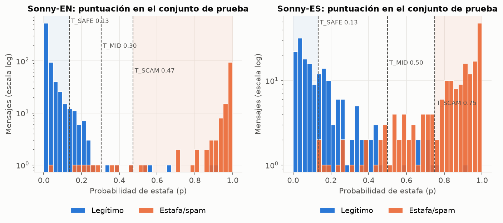
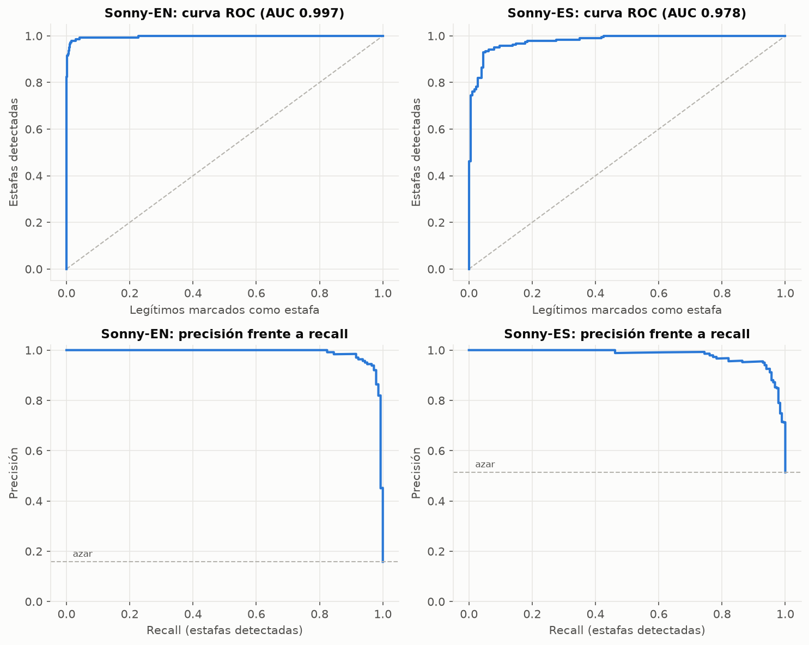
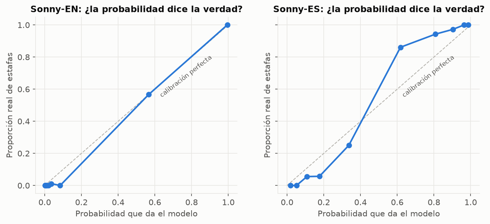
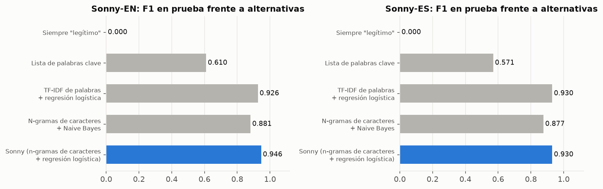
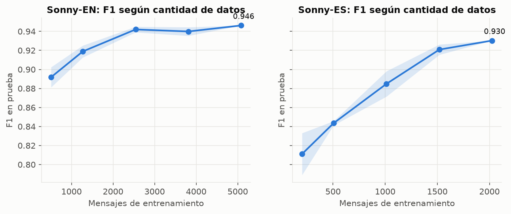
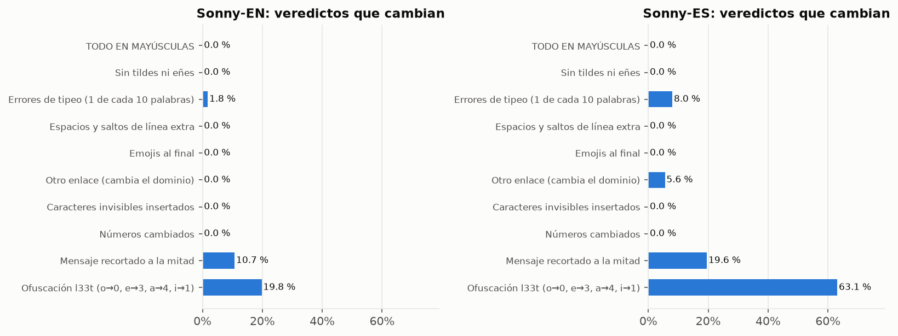
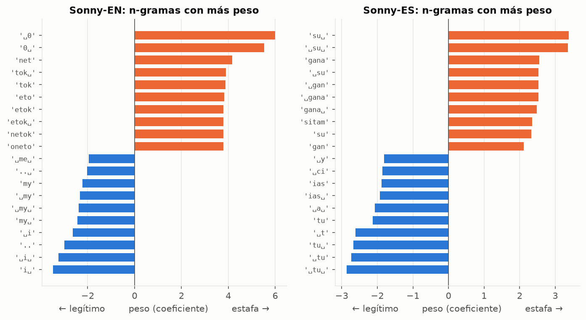

# Análisis completo de los modelos de Sonny

> Generado automáticamente por `06_analisis.py` (2026-11-07 08:55, 62 s). Interpretación y guion de demostración: [`../ANALISIS_MODELO.md`](../ANALISIS_MODELO.md).

## 1. Datos

**Sonny-EN:** 5981 mensajes (944 estafa/spam), 5083 para desarrollo y 898 para prueba. Etiquetas corregidas: 0.

| Fuente | Canal | Mensajes | Estafa/spam | Mediana de palabras |
|---|---|---|---|---|
| `mendeley_sms` | sms | 844 | 324 | 18 |
| `uci_sms` | sms | 5137 | 620 | 12 |

**Sonny-ES:** 2384 mensajes (1223 estafa/spam), 2026 para desarrollo y 358 para prueba. Etiquetas corregidas: 10.

| Fuente | Canal | Mensajes | Estafa/spam | Mediana de palabras |
|---|---|---|---|---|
| `softecapps` | sms | 1055 | 557 | 7 |
| `spaphish` | email | 1329 | 666 | 80 |

## 2. Métricas en prueba con intervalo de confianza del 95 %

Bootstrap de 1.000 remuestreos del conjunto de prueba, umbral 0,5.

| Modelo | Precisión | Recall | F1 | ROC-AUC |
|---|---|---|---|---|
| Sonny-EN | 0.964 (0.929–0.992) | 0.930 (0.885–0.970) | 0.946 (0.918–0.971) | 0.997 (0.993–0.999) |
| Sonny-ES | 0.954 (0.920–0.979) | 0.908 (0.863–0.944) | 0.930 (0.901–0.954) | 0.978 (0.965–0.989) |

## 3. Umbrales

**Sonny-EN**

| Umbral | | Precisión | Recall | Legítimos marcados |
|---|---|---|---|---|
| 0.100 |  | 69.1 % | 99.3 % | 8.3 % |
| 0.135 | T_SAFE | 77.0 % | 99.3 % | 5.6 % |
| 0.200 |  | 88.0 % | 97.9 % | 2.5 % |
| 0.300 |  | 94.4 % | 95.1 % | 1.1 % |
| 0.303 | T_MID | 94.4 % | 95.1 % | 1.1 % |
| 0.400 |  | 95.7 % | 93.7 % | 0.8 % |
| 0.472 | T_SCAM | 96.4 % | 93.0 % | 0.7 % |
| 0.500 |  | 96.4 % | 93.0 % | 0.7 % |
| 0.600 |  | 97.7 % | 91.5 % | 0.4 % |
| 0.700 |  | 98.5 % | 91.5 % | 0.3 % |
| 0.800 |  | 98.4 % | 89.4 % | 0.3 % |
| 0.900 |  | 99.2 % | 84.5 % | 0.1 % |

**Sonny-ES**

| Umbral | | Precisión | Recall | Legítimos marcados |
|---|---|---|---|---|
| 0.100 |  | 68.1 % | 100.0 % | 49.4 % |
| 0.132 | T_SAFE | 71.5 % | 99.5 % | 42.0 % |
| 0.200 |  | 81.4 % | 97.8 % | 23.6 % |
| 0.300 |  | 87.6 % | 96.2 % | 14.4 % |
| 0.400 |  | 92.5 % | 94.0 % | 8.0 % |
| 0.500 | T_MID | 95.4 % | 90.8 % | 4.6 % |
| 0.600 |  | 95.7 % | 84.8 % | 4.0 % |
| 0.700 |  | 96.7 % | 79.3 % | 2.9 % |
| 0.750 | T_SCAM | 98.6 % | 75.0 % | 1.1 % |
| 0.800 |  | 99.2 % | 70.7 % | 0.6 % |
| 0.900 |  | 98.9 % | 50.5 % | 0.6 % |

## 4. Calibración

| Modelo | Brier (menor es mejor; azar ≈ 0,25) |
|---|---|
| Sonny-EN | 0.0129 |
| Sonny-ES | 0.0619 |

## 5. Comparación con alternativas

**Sonny-EN**

| Método | Precisión | Recall | F1 | ROC-AUC |
|---|---|---|---|---|
| Siempre "legítimo" | 0.0 % | 0.0 % | 0.000 | 0.500 |
| Lista de palabras clave | 58.8 % | 63.4 % | 0.610 | 0.789 |
| TF-IDF de palabras + regresión logística | 92.3 % | 93.0 % | 0.926 | 0.987 |
| N-gramas de caracteres + Naive Bayes | 96.6 % | 81.0 % | 0.881 | 0.976 |
| **Sonny** (n-gramas de caracteres + regresión logística) | 96.4 % | 93.0 % | 0.946 | 0.997 |

**Sonny-ES**

| Método | Precisión | Recall | F1 | ROC-AUC |
|---|---|---|---|---|
| Siempre "legítimo" | 0.0 % | 0.0 % | 0.000 | 0.500 |
| Lista de palabras clave | 65.5 % | 50.5 % | 0.571 | 0.624 |
| TF-IDF de palabras + regresión logística | 95.4 % | 90.8 % | 0.930 | 0.975 |
| N-gramas de caracteres + Naive Bayes | 90.2 % | 85.3 % | 0.877 | 0.935 |
| **Sonny** (n-gramas de caracteres + regresión logística) | 95.4 % | 90.8 % | 0.930 | 0.978 |

## 6. Curva de aprendizaje

Media de 3 submuestras estratificadas por tamaño; la banda es ± 1 desviación típica.

| Modelo | Fracción | Mensajes | F1 | Recall | ROC-AUC |
|---|---|---|---|---|---|
| Sonny-EN | 10% | 508 | 0.892 ± 0.011 | 83.3 % | 0.991 |
| Sonny-EN | 25% | 1271 | 0.919 ± 0.006 | 87.8 % | 0.995 |
| Sonny-EN | 50% | 2542 | 0.942 ± 0.003 | 91.5 % | 0.996 |
| Sonny-EN | 75% | 3812 | 0.940 ± 0.005 | 91.8 % | 0.997 |
| Sonny-EN | 100% | 5083 | 0.946 ± 0.000 | 93.0 % | 0.997 |
| Sonny-ES | 10% | 203 | 0.811 ± 0.022 | 76.6 % | 0.891 |
| Sonny-ES | 25% | 506 | 0.843 ± 0.002 | 80.1 % | 0.933 |
| Sonny-ES | 50% | 1013 | 0.885 ± 0.013 | 84.4 % | 0.958 |
| Sonny-ES | 75% | 1520 | 0.921 ± 0.005 | 89.7 % | 0.970 |
| Sonny-ES | 100% | 2026 | 0.930 ± 0.000 | 90.8 % | 0.978 |

## 7. Generalización entre fuentes

Se entrena solo con una fuente y se prueba con otra que el modelo nunca vio.

| Modelo | Entrena con | Prueba con | n | Precisión | Recall | F1 | ROC-AUC |
|---|---|---|---|---|---|---|---|
| Sonny-EN | `mendeley_sms` | `mendeley_sms` (prueba) | 127 | 98.0 % | 100.0 % | 0.990 | 0.999 |
| Sonny-EN | `mendeley_sms` | `uci_sms` | 5137 | 90.1 % | 93.5 % | 0.918 | 0.992 |
| Sonny-EN | `uci_sms` | `mendeley_sms` | 844 | 97.7 % | 92.3 % | 0.949 | 0.997 |
| Sonny-EN | `uci_sms` | `uci_sms` (prueba) | 771 | 94.2 % | 87.1 % | 0.905 | 0.994 |
| Sonny-ES | `softecapps` | `softecapps` (prueba) | 159 | 95.0 % | 90.5 % | 0.927 | 0.970 |
| Sonny-ES | `softecapps` | `spaphish` | 1329 | 50.7 % | 42.0 % | 0.460 | 0.514 |
| Sonny-ES | `spaphish` | `softecapps` | 1055 | 53.4 % | 37.0 % | 0.437 | 0.541 |
| Sonny-ES | `spaphish` | `spaphish` (prueba) | 199 | 95.8 % | 92.0 % | 0.939 | 0.991 |

## 8. Cruce de idiomas

| Modelo → mensajes | Precisión | Recall | F1 | ROC-AUC |
|---|---|---|---|---|
| Sonny-EN → mensajes en EN | 96.4 % | 93.0 % | 0.946 | 0.997 |
| Sonny-EN → mensajes en ES | 51.3 % | 53.3 % | 0.523 | 0.550 |
| Sonny-ES → mensajes en EN | 16.6 % | 47.2 % | 0.245 | 0.493 |
| Sonny-ES → mensajes en ES | 95.4 % | 90.8 % | 0.930 | 0.978 |

## 9. Robustez

Cada transformación se aplica a todos los mensajes de prueba. *Veredicto* = 🛑/⚠️/✅ sin internet.

**Sonny-EN**

| Transformación | Afectados | Cambio medio de p | Veredictos que cambian | Recall antes → después | Estafas ✅ antes → después |
|---|---|---|---|---|---|
| TODO EN MAYÚSCULAS | 875 | 0.000 | 0.0 % | 93.0 % → 93.0 % | 1 → 1 |
| Sin tildes ni eñes | 22 | 0.000 | 0.0 % | 93.0 % → 93.0 % | 1 → 1 |
| Errores de tipeo (1 de cada 10 palabras) | 452 | 0.009 | 1.8 % | 93.0 % → 93.0 % | 1 → 1 |
| Espacios y saltos de línea extra | 895 | 0.000 | 0.0 % | 93.0 % → 93.0 % | 1 → 1 |
| Emojis al final | 898 | 0.000 | 0.0 % | 93.0 % → 93.0 % | 1 → 1 |
| Otro enlace (cambia el dominio) | 71 | 0.000 | 0.0 % | 93.0 % → 93.0 % | 1 → 1 |
| Caracteres invisibles insertados | 896 | 0.000 | 0.0 % | 93.0 % → 93.0 % | 1 → 1 |
| Números cambiados | 248 | 0.000 | 0.0 % | 93.0 % → 93.0 % | 1 → 1 |
| Mensaje recortado a la mitad | 895 | 0.070 | 10.7 % | 93.0 % → 62.0 % | 1 → 15 |
| Ofuscación l33t (o→0, e→3, a→4, i→1) | 896 | 0.087 | 19.8 % | 93.0 % → 85.9 % | 1 → 3 |

**Sonny-ES**

| Transformación | Afectados | Cambio medio de p | Veredictos que cambian | Recall antes → después | Estafas ✅ antes → después |
|---|---|---|---|---|---|
| TODO EN MAYÚSCULAS | 358 | 0.000 | 0.0 % | 90.8 % → 90.8 % | 1 → 1 |
| Sin tildes ni eñes | 248 | 0.000 | 0.0 % | 90.8 % → 90.8 % | 1 → 1 |
| Errores de tipeo (1 de cada 10 palabras) | 249 | 0.026 | 8.0 % | 90.8 % → 91.8 % | 1 → 2 |
| Espacios y saltos de línea extra | 358 | 0.001 | 0.0 % | 90.8 % → 90.8 % | 1 → 1 |
| Emojis al final | 358 | 0.000 | 0.0 % | 90.8 % → 90.8 % | 1 → 1 |
| Otro enlace (cambia el dominio) | 72 | 0.017 | 5.6 % | 90.8 % → 90.2 % | 1 → 1 |
| Caracteres invisibles insertados | 358 | 0.000 | 0.0 % | 90.8 % → 90.8 % | 1 → 1 |
| Números cambiados | 175 | 0.000 | 0.0 % | 90.8 % → 90.8 % | 1 → 1 |
| Mensaje recortado a la mitad | 358 | 0.089 | 19.6 % | 90.8 % → 88.6 % | 1 → 3 |
| Ofuscación l33t (o→0, e→3, a→4, i→1) | 358 | 0.277 | 63.1 % | 90.8 % → 62.0 % | 1 → 0 |

**Ataque con caracteres invisibles, antes y después del arreglo** (el preprocesado elimina ahora los caracteres Unicode `Cf`):

| Modelo | Recall sin ataque | Con ataque, ANTES del arreglo | Con ataque, DESPUÉS |
|---|---|---|---|
| Sonny-EN | 93.0 % | 89.4 % | 93.0 % |
| Sonny-ES | 92.4 % | 57.1 % | 90.8 % |

**Palabras frente a caracteres** (recall de estafas, umbral 0,5): TF-IDF de palabras + regresión logística frente a Sonny (n-gramas de caracteres), con los mismos datos.

| Modelo | Transformación | Palabras | Caracteres (Sonny) |
|---|---|---|---|
| Sonny-EN | Sin cambios | 93.0 % | 93.0 % |
| Sonny-EN | Tipeo en 10 % de las palabras | 93.0 % | 93.0 % |
| Sonny-EN | Tipeo en 30 % de las palabras | 88.0 % | 92.3 % |
| Sonny-EN | Ofuscación l33t | 78.2 % | 85.9 % |
| Sonny-ES | Sin cambios | 90.8 % | 90.8 % |
| Sonny-ES | Tipeo en 10 % de las palabras | 91.3 % | 91.8 % |
| Sonny-ES | Tipeo en 30 % de las palabras | 88.0 % | 90.2 % |
| Sonny-ES | Ofuscación l33t | 67.9 % | 62.0 % |

## 10. Análisis de errores

**Sonny-EN**: 10 estafas no detectadas y 5 legítimos marcados (umbral 0,5).

Estafas con la puntuación más baja:

| p | Sin internet | Fuente | Mensaje |
|---|---|---|---|
| 0.035 | ✅ | `uci_sms`/spam | Do you realize that in about 40 years, we'll have thousands of old ladies running around with tattoos? |
| 0.162 | ⚠️ | `uci_sms`/spam | Oh my god! I've found your number again! I'm so glad, text me back xafter this msgs cst std ntwk chg £1.50 |
| 0.189 | ⚠️ | `uci_sms`/spam | Hi ya babe x u 4goten bout me?' scammers getting smart..Though this is a regular vodafone no, if you respond … |
| 0.219 | ⚠️ | `uci_sms`/spam | For sale - arsenal dartboard. Good condition but no doubles or trebles! |
| 0.248 | ⚠️ | `uci_sms`/spam | Guess who am I?This is the first time I created a web page WWW.ASJESUS.COM read all I wrote. I'm waiting for … |
| 0.267 | ⚠️ | `uci_sms`/spam | Latest News! Police station toilet stolen, cops have nothing to go on! |

Legítimos con la puntuación más alta:

| p | Sin internet | Fuente | Mensaje |
|---|---|---|---|
| 0.915 | 🛑 | `mendeley_sms` | NEFT Transaction with reference number 456367 for Rs.9000 has been credited to the beneficiary account on 5th… |
| 0.888 | 🛑 | `uci_sms` | I (Career Tel) have added u as a contact on INDYAROCKS.COM to send FREE SMS. To remove from phonebook - sms N… |
| 0.651 | 🛑 | `uci_sms` | WHEN THE FIRST STRIKE IS A RED ONE. THE BIRD + ANTELOPE BEGIN TOPLAY IN THE FIELDOF SELFINDEPENDENCE BELIEVE … |
| 0.553 | 🛑 | `uci_sms` | Ryder unsold.now gibbs. |
| 0.538 | 🛑 | `uci_sms` | Any chance you might have had with me evaporated as soon as you violated my privacy by stealing my phone numb… |
| 0.451 | ⚠️ | `uci_sms` | Your bill at 3 is £33.65 so thats not bad! |

**Sonny-ES**: 17 estafas no detectadas y 8 legítimos marcados (umbral 0,5).

Estafas con la puntuación más baja:

| p | Sin internet | Fuente | Mensaje |
|---|---|---|---|
| 0.130 | ✅ | `spaphish`/phishing | Tu cuenta Uber se cerrará en 30 días a menos que inicies sesión Hola, Ricardo Molina: Hace mucho que no usas … |
| 0.132 | ⚠️ | `spaphish`/phishing | Nuevos cambios de precios de su membresía Cambios de precios Hola, Diego Ramos: El costo de tu plan ha cambia… |
| 0.153 | ⚠️ | `softecapps`/spam | Hola seré tu nutricionista online |
| 0.179 | ⚠️ | `spaphish`/phishing | Hemos recibido una solicitud de cambio de Numero. Listo tu cambio de numero se efectuara en las proximas hora… |
| 0.245 | ⚠️ | `softecapps`/spam | Este es un aviso de tu factura vencida |
| 0.254 | ⚠️ | `spaphish`/phishing | Acto admin XNU083167 enviado al buzon YDP628570 HACIENDA Secretaría de Hacienda y Crédito Público Se te ha en… |

Legítimos con la puntuación más alta:

| p | Sin internet | Fuente | Mensaje |
|---|---|---|---|
| 0.913 | 🛑 | `spaphish` | Notificación de Entrega SHEIN Mercado Chic Estimado Cliente, Su pedido MCHQWE99990YYKK con número de seguimie… |
| 0.753 | 🛑 | `spaphish` | Convierte tu cuenta a Mercado Pago Wallet Es fácil. Y está todo aquí. Hazlo para seguir usándola como siempre… |
| 0.740 | ⚠️ | `softecapps` | Te extrano y quiero verte |
| 0.724 | ⚠️ | `spaphish` | Dale la bienvenida a tu premio: Suscripción gratis a Spotify Premium - 3 meses Disfrútalo ahora. Gracias por … |
| 0.707 | ⚠️ | `softecapps` | Tu suscripcion expirara pronto |
| 0.666 | ⚠️ | `softecapps` | Extendimos tu periodo de prueba gratis |

## 11. Explicabilidad

`␣` = límite de palabra.

**Sonny-EN**: hacia estafa: `␣0`, `0␣`, `net`, `tok␣`, `tok`, `eto`, `oneto`, `netok`, `etok␣`, `etok`, `honet`, `neto`

Hacia legítimo: `i␣`, `␣i␣`, `..`, `␣i`, `my␣`, `␣my␣`, `␣my`, `my`, `..␣`, `␣me␣`, `:)`, `␣m`

**Sonny-ES**: hacia estafa: `su␣`, `␣su␣`, `gana`, `␣su`, `␣gan`, `␣gana`, `gana␣`, `sitam`, `su`, `gan`, `␣con␣`, `con␣`

Hacia legítimo: `␣tu␣`, `␣tu`, `tu␣`, `␣t`, `tu`, `␣a␣`, `ias␣`, `ias`, `␣ci`, `␣y`, `url`, `rlt`

## 12. Detector de idioma

Matriz de confusión (filas = real EN/ES, columnas = predicho EN/ES): `[[898, 0], [3, 355]]` sobre 1256 mensajes.

| Longitud | Mensajes | Exactitud | Con confianza ≥ 0,8 |
|---|---|---|---|
| 1–3 palabras | 23 | 100.0 % | 95.7 % |
| 4–8 palabras | 392 | 99.7 % | 96.9 % |
| 9–20 palabras | 373 | 100.0 % | 99.2 % |
| más de 20 | 468 | 99.6 % | 99.1 % |

Mensajes cortos o mezclados (*principal* = se usa el idioma del usuario):

| Mensaje | p(es) | Decisión | Esperado |
|---|---|---|---|
| ok | 0.02 | en | cualquiera |
| gracias | 0.82 | es | es |
| thanks | 0.02 | en | en |
| hola | 0.46 | principal | es |
| hi | 0.03 | en | en |
| Ok, nos vemos mañana | 0.58 | principal | es |
| See you tomorrow! | 0.02 | en | en |
| Tu cuenta de Netflix ha sido suspendida | 0.89 | es | es |
| Your Netflix account is on hold | 0.04 | en | en |
| Hola, your package is waiting | 0.03 | en | cualquiera |
| Call me cuando puedas | 0.40 | principal | cualquiera |
| Su código OTP es 4821 | 0.34 | principal | es |
| Your OTP is 4821 | 0.01 | en | en |
| BBVA | 0.16 | en | cualquiera |
| 😀😀 | 0.05 | en | cualquiera |

## 13. Simulación de la cascada (conjunto de prueba)

| Modelo | Se quedan en el celular (🛑 sin IA) | Van a la IA (con internet) |
|---|---|---|
| Sonny-EN | 15.3 % | 84.7 % |
| Sonny-ES | 39.1 % | 60.9 % |

Sin internet (filas = realidad, columnas = veredicto):

| Modelo | Realidad | 🛑 Estafa | ⚠️ Dudoso | ✅ Parece normal |
|---|---|---|---|---|
| Sonny-EN | Estafa/spam | 132 | 9 | 1 |
| Sonny-EN | Legítimo | 5 | 37 | 714 |
| Sonny-ES | Estafa/spam | 138 | 45 | 1 |
| Sonny-ES | Legítimo | 2 | 71 | 101 |

## 14. Batería realista (consideraciones.md 11.3)

| Idioma | Tipo | Real | p | Sin internet | ¿Bien? | Lo que más empuja a estafa | Lo que más empuja a legítimo |
|---|---|---|---|---|---|---|---|
| es | falso paquete | estafa | 0.765 | 🛑 | ✅ | `su␣`, `␣su␣`, `␣su` | `url`, `rlt`, `urlt` |
| es | falso banco | estafa | 0.715 | ⚠️ | ✅ | `␣su`, `su␣`, `␣su␣` | `url`, `rlt`, `urlt` |
| es | hijo en apuros | estafa | 0.129 | ✅ | ❌ | `pi`, `ama`, `␣romp` | `hola␣`, `ola␣`, `lu` |
| es | falso premio | estafa | 0.783 | 🛑 | ✅ | `gana`, `␣gan`, `␣gana` | `␣fel`, `␣feli`, `url` |
| es | falsa multa | estafa | 0.418 | ⚠️ | ✅ | `iene␣`, `ene␣`, `ne␣` | `sito␣`, `␣t`, `url` |
| es | falso trabajo | estafa | 0.343 | ⚠️ | ✅ | `␣gan`, `gan`, `␣ga` | `␣dia␣`, `lar`, `sa` |
| es | inversión | estafa | 0.878 | 🛑 | ✅ | `su␣`, `␣su␣`, `␣ga` | `gara`, `ias␣`, `ias` |
| es | código de verificación | legítimo | 0.403 | ⚠️ | ✅ | `␣con␣`, `con␣`, `nad` | `␣tu␣`, `tu␣`, `␣tu` |
| es | cita médica | legítimo | 0.021 | ✅ | ✅ | `su␣`, `␣su␣`, `su` | `cita␣`, `␣ci`, `orio` |
| es | mensaje familiar | legítimo | 0.344 | ⚠️ | ✅ | `domin`, `dom`, `domi` | `o?`, `o?␣`, `␣come` |
| en | fake package | estafa | 0.769 | 🛑 | ✅ | `0␣`, `:␣`, `tok␣` | `␣i`, `␣it`, `␣it␣` |
| en | fake bank | estafa | 0.874 | 🛑 | ✅ | `:␣`, `tok␣`, `tok` | `␣h`, `en␣`, `nt␣` |
| en | family in trouble | estafa | 0.110 | ✅ | ❌ | `xt`, `ne`, `xt␣` | `my␣`, `␣my␣`, `␣my` |
| en | fake prize | estafa | 0.867 | 🛑 | ✅ | `:␣`, `on`, `tok␣` | `␣i`, `␣it`, `␣it␣` |
| en | fake fine | estafa | 0.399 | ⚠️ | ✅ | `␣0`, `0␣`, `to` | `␣h`, `hou`, `thin` |
| en | fake job | estafa | 0.212 | ⚠️ | ✅ | `0␣`, `ex`, `ne` | `␣me`, `no␣`, `␣no␣` |
| en | investment | estafa | 0.650 | 🛑 | ✅ | `␣0`, `0␣`, `one` | `␣i`, `␣m`, `o.` |
| en | verification code | legítimo | 0.347 | ⚠️ | ✅ | `␣0`, `0.`, `on` | `␣i`, `␣it`, `␣it␣` |
| en | appointment | legítimo | 0.265 | ⚠️ | ✅ | `␣0`, `0␣`, `:␣` | `␣i`, `nt␣`, `is` |
| en | family message | legítimo | 0.074 | ✅ | ✅ | `nne`, `ne`, `su` | `␣comi`, `comi`, `comin` |

**18/20** (estafa nunca ✅, legítimo nunca 🛑).

## 15. Velocidad y tamaño en JavaScript

Node 24.18.0, 2000 análisis por modelo.

| Archivo | Tamaño | Cargar (JSON.parse) | Por mensaje (mediana) | p99 |
|---|---|---|---|---|
| `en.sonny` | 0.83 MB | 16 ms | 0.130 ms | 1.886 ms |
| `es.sonny` | 0.82 MB | 12 ms | 0.064 ms | 1.834 ms |
| `lang.sonny` | 0.14 MB | 2 ms | 0.082 ms | 1.296 ms |
